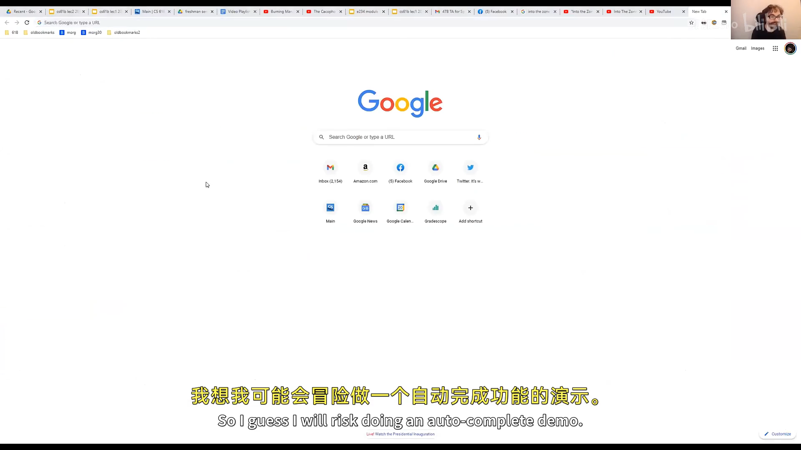
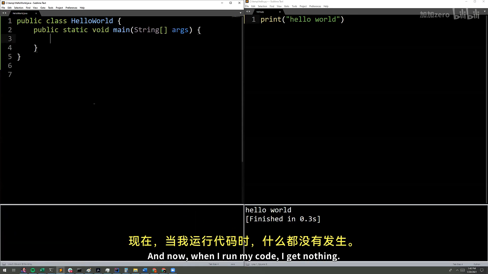
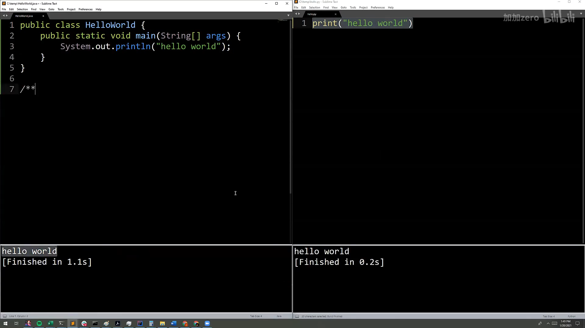
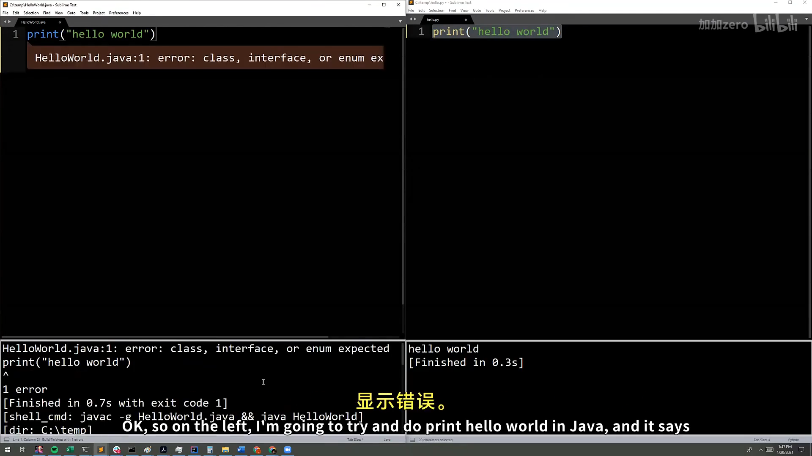
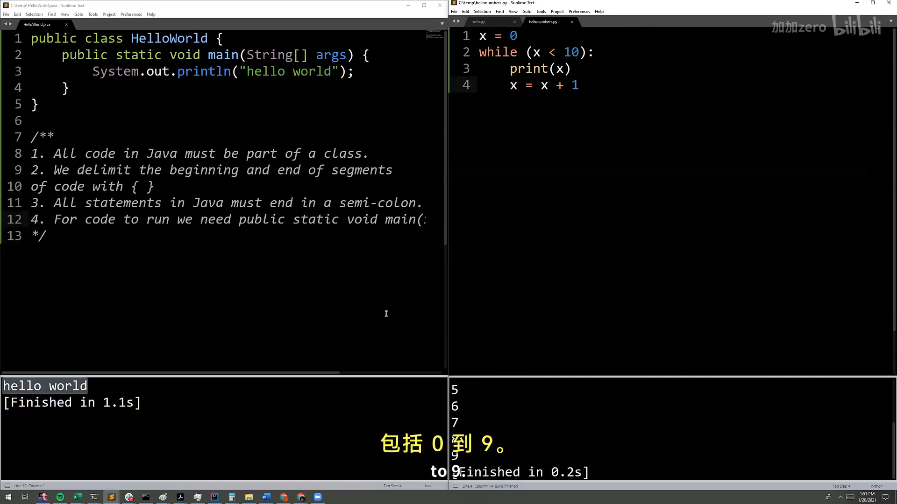
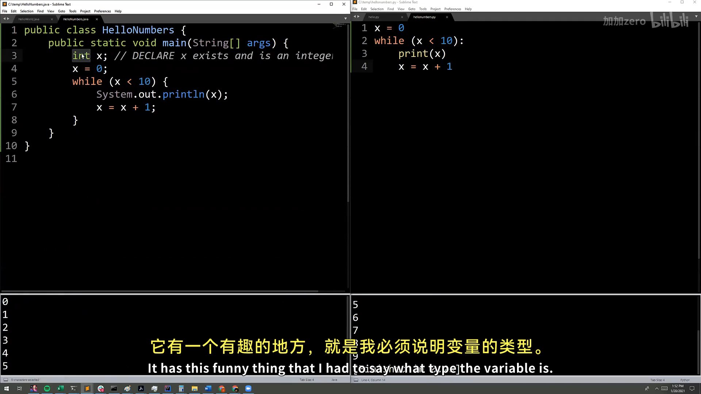
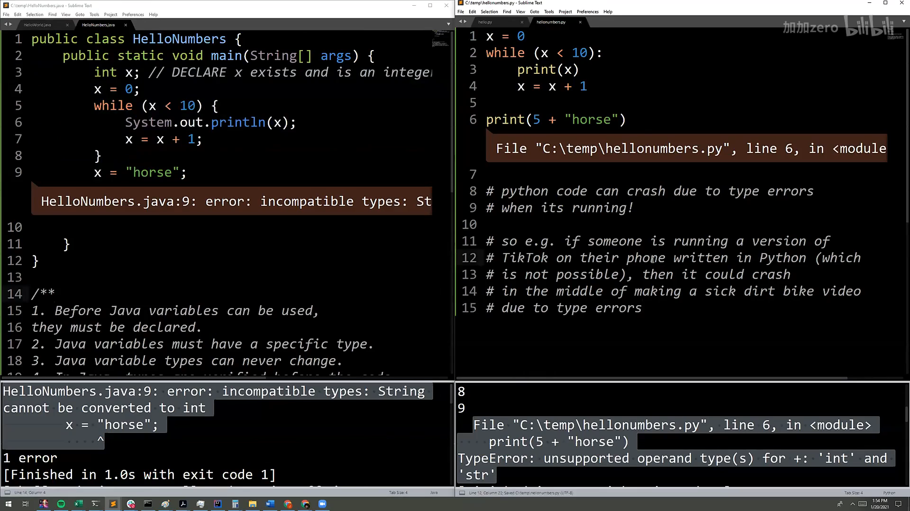

# CS61B 第 1 讲：课程介绍与 Hello World（Intro, Hello World Java）

> **本电子书信息**
> - 来源视频：[【数据结构与算法 CS61B 2021】伯克利大学—中英字幕 p0 1_Intro, Hello World Java](https://www.bilibili.com/video/BV1FSzNYpE7s/?p=1)
> - 课程讲义：[Hug61B · 1.1 Essentials](https://joshhug.gitbooks.io/hug61b/content/chap1/chap11.html)
> - 讲义版权：本课程全部材料由 **Josh Hug**（UC Berkeley CS61B）以 **Creative Commons 4.0 BY-NC-SA** 许可发布——可自由分享、演绎，但须署名 Josh Hug、以相同许可共享，且不得商用。
> - 本书由课堂录像字幕重构而成，术语以官方讲义为准；示意图为官方讲义原图，演示截图取自原视频。

这是 CS61B 的第一讲。前半部分是课程介绍（为什么学这门课、课程怎么组织），后半部分是 Java 入门：Hello World、编译运行、变量与循环、静态类型，以及"函数"在 Java 里的形态。

---

## 一、课程介绍：数据结构与算法为何重要

这门课假定你已经会编程，目标不是教你 Java 语法，而是让你**写得更快、更省空间、也更容易维护**。具体来说，课程覆盖设计、构建、测试和调试大型程序，并顺带学习 git、IntelliJ、JUnit 等真实工具。

为什么要学数据结构与算法？Josh 举了几个例子：

- **Google 自动补全**：你在搜索框里打字，它能瞬间给出建议，背后依赖的是一种叫 **trie（字典树）** 的数据结构——本课后面会讲到。
- **AlphaGo / 围棋、国际象棋 AI**：击败人类的算法，正是本课程为机器学习打下的基础。
- **GPT-3**：能根据一句话生成代码，这背后同样是算法与数据结构的支撑。



一句话：**这门课是求职面试（哈希表、二叉搜索树、堆……）与后续机器学习/系统课程的地基。**

---

## 二、Hello World：第一个 Java 程序

第一个 Java 程序长这样：

```java
public class HelloWorld {
    public static void main(String[] args) {
        System.out.println("Hello world!");
    }
}
```

对从 Python 过来的人来说，这显得无比啰嗦，但每个词都有它的理由。几个关键语法特征：

- 程序由一个**类声明**组成，用 `public class` 声明——**Java 里所有代码都活在类里**；
- 实际运行的代码在一个叫 `main` 的方法里，声明为 `public static void main(String[] args)`；
- 用花括号 `{ }` 表示一段代码的开始与结束；
- 每条语句必须以**分号**结尾。



### 关于 Java 的几个观察

1. **所有代码必须在类里**——这是为大型软件工程做的设计取舍；
2. 用**花括号**界定代码段；
3. 所有语句以**分号**结束；
4. 要运行代码，得有一个 `main` 方法（现在还不必深究它是什么，第二讲会讲）。



---

## 三、编译与运行：javac 与 java

运行一个 Java 程序要走两个程序：先**编译器** `javac`，再**解释器** `java`。

```bash
$ javac HelloWorld.java   # 编译，生成 HelloWorld.class
$ java HelloWorld         # 解释执行
Hello World!
```

- 编译时写 `.java`，解释时不写 `.class`（"就是这样"）；
- `javac` 之后看起来"什么都没发生"，但目录里多了一个 `HelloWorld.class`——那是 Java 字节码，只有 Java 解释器才看得懂。



---

## 四、变量与循环：HelloNumbers

下面这个程序打印 0 到 9：

```java
public class HelloNumbers {
    public static void main(String[] args) {
        int x = 0;
        while (x < 10) {
            System.out.print(x + " ");
            x = x + 1;
        }
    }
}
```

几个值得注意的点：

- 变量 `x` 必须**先声明、并给定类型**，才能使用；
- 循环体包在花括号里，判断条件包在圆括号里；
- `System.out.print`（不带 `ln`）不换行；`x + " "` 里的 `+` 是**字符串拼接**，用来给数字之间加空格。

如果你在 Java 里直接写 `x = 0` 而不先声明 `int x`，会得到一个神秘的报错 "cannot find symbol"——因为 **Java 不允许你说"某物等于某物"，它必须先知道这个"某物"存在、且是什么类型**。



---

## 五、静态类型（Static Typing）

Java 最重要的特性之一：**所有变量和表达式都有一个静态类型**，变量只能存该类型的值，而且类型**永远不能变**。

```java
int x = 0;
x = "horse";   // 编译错误：String 不能转换为 int
```

编译器在程序**运行之前**就拒绝这段代码。这意味着：

1. **更容易调试**——类型不兼容在编译期就被揪出来；
2. **用户永远不会遇到类型错误**——比如 Android App 只发布编译后的 `.class` 文件，类型错误早已被编译器拦下；
3. **代码更好读懂**——每个变量、参数、函数都有声明类型，一眼就知道它是什么。

对比 Python 这类**动态类型**语言：类型错误要等到**运行时**才暴露。Josh 把 Python 比作"徒手攀岩"——快，但危险；Java 则是"系着绳索、戴着头盔"。



> **思考题**：`System.out.println(5 + "10")` 打印的是 `510` 还是 `15`？——`+` 遇到字符串就是拼接，所以是 `510`；而 `5 + 10` 才是整数加法 `15`。

---

## 六、函数与方法（Functions & Methods）

Python 里函数可以在任何地方声明：

```python
def larger(x, y):
    if x > y:
        return x
    return y
print(larger(8, 10))
```

Java 里，**所有代码都在类里**，所以"函数"必须属于某个类——类里的函数通常叫**方法（method）**。等价写法：

```java
public class LargerDemo {
    public static int larger(int x, int y) {
        if (x > y) {
            return x;
        }
        return y;
    }

    public static void main(String[] args) {
        System.out.println(larger(8, 10));
    }
}
```

新语法是 `public static`（粗略对应 Python 的 `def`）。和变量一样，**每个参数都要声明类型**，**函数本身也要声明返回类型**（`int`）。



这些啰嗦的语法看着像"拖慢速度"，但它们是现在还不懂的**安全装备**：写小程序时显得多余，写大程序时你会感激它们。

---

## 附：官方参考与延伸阅读

- **本讲讲义**（1.1 Essentials）：<https://joshhug.gitbooks.io/hug61b/content/chap1/chap11.html>
- **Java 参考（免费电子书）**：Paul Hilfinger《A Java Reference》
- **Head First Java**：Kathy Sierra & Bert Bates
- **各语言的 Hello World**：<https://www.rosettacode.org/wiki/Hello_world/Text>
- **Java 字节码**：<https://en.wikipedia.org/wiki/Java_bytecode>
- **代码风格指南**（课程官方）：<https://sp19.datastructur.es/materials/guides/style-guide.html>

---

> **版权与许可**：本电子书中的课堂讲解内容重构自 Josh Hug（UC Berkeley）CS61B 课程录像；课程全部材料依据 **Creative Commons 4.0 BY-NC-SA** 许可发布。请在使用时署名 Josh Hug、以相同许可共享，且不得用于商业用途。书中示意图来自官方讲义原图，演示截图来自原视频，相应权利归原作者与视频权利人所有。
