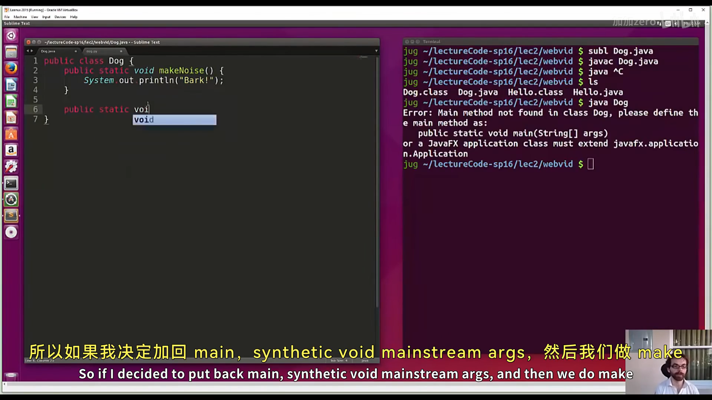
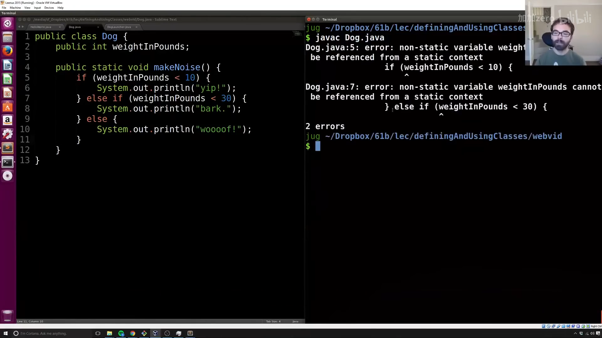
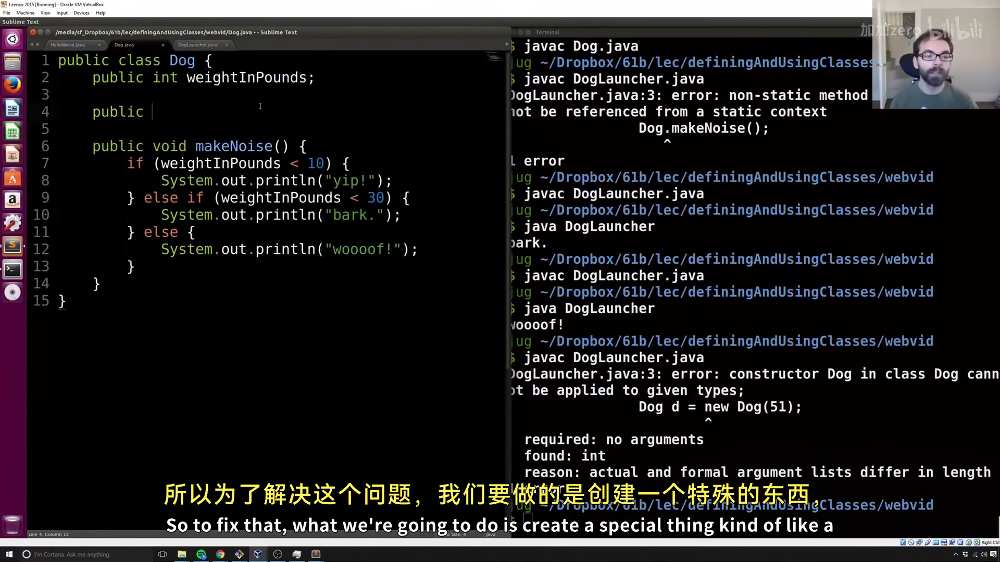
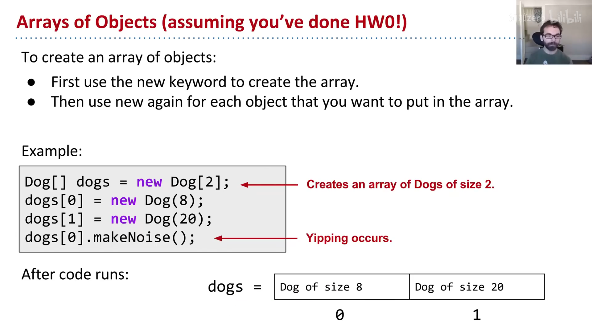
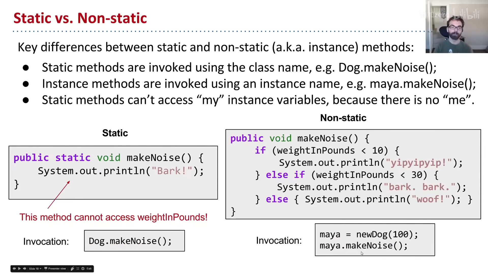
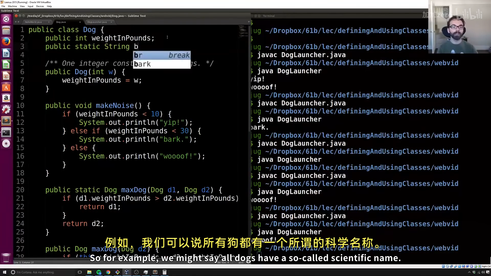
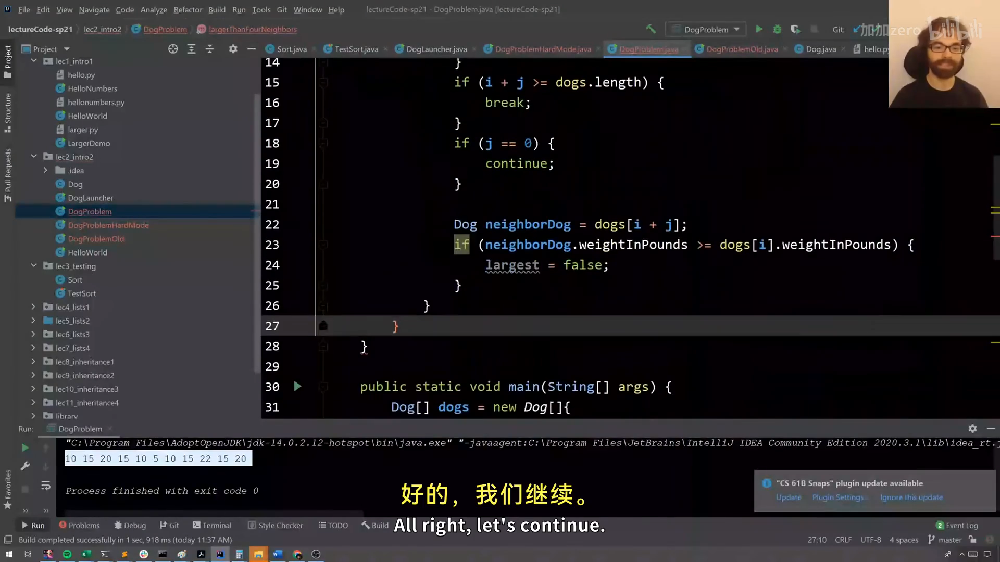

# CS61B 第 2 讲：定义与使用类（Defining and Using Classes）

> **本电子书信息**
> - 来源视频：[【数据结构与算法 CS61B 2021】伯克利大学—中英字幕 p1 2_Defining and Using Classes](https://www.bilibili.com/video/BV1FSzNYpE7s/?p=2)
> - 课程讲义：[Hug61B · 1.2 Objects](https://joshhug.gitbooks.io/hug61b/content/chap1/chap12.html)
> - 讲义版权：本课程全部材料由 **Josh Hug**（UC Berkeley CS61B）以 **Creative Commons 4.0 BY-NC-SA** 许可发布——可自由分享、演绎，但须署名 Josh Hug、以相同许可共享，且不得商用。
> - 本书由课堂录像字幕重构而成，术语以官方讲义为准；示意图为官方讲义原图，演示截图取自原视频。

上一讲我们写了第一个 Java 程序。这一讲回答"类到底怎么用"：静态方法、实例变量、构造函数、对象数组、`this`，以及贯穿全课程的核心理念——**用类与辅助方法管理复杂度**。

---

## 一、静态方法 vs 非静态方法

Java 里所有代码都在类里。看这个 `Dog` 类：

```java
public class Dog {
    public static void makeNoise() {
        System.out.println("Bark!");
    }
}
```

直接 `java Dog` 会报错：`Main method not found`——因为我们只定义了 Dog **能做什么**（叫），却还没让它运行。要运行它，可以给它加 `main`，或者另建一个"客户端"类：

```java
public class DogLauncher {
    public static void main(String[] args) {
        Dog.makeNoise();   // 用类名调用静态方法
    }
}
```

调用另一个类的类，叫做那个类的**客户端（client）**。两种做法（加 `main` vs 建客户端类）各有优劣，实践多了自然体会。



### 实例变量与对象实例化

不是所有狗都一样：有的爱尖叫，有的叫声洪亮。与其为每种狗建一个类（`TinyDog`、`MalamuteDog`），更自然的做法是**实例化** `Dog`，让行为取决于具体那只狗的状态：

```java
public class Dog {
    public int weightInPounds;

    public void makeNoise() {              // 注意：没有 static
        if (weightInPounds < 10) {
            System.out.println("yipyipyip!");
        } else if (weightInPounds < 30) {
            System.out.println("bark. bark.");
        } else {
            System.out.println("woof!");
        }
    }
}
```

```java
Dog d;
d = new Dog();
d.weightInPounds = 20;
d.makeNoise();      // 输出 "bark. bark."
```

关键术语：

- **对象（Object）**：任何类的实例；
- **实例变量（instance variable / non-static variable）**：属于对象自己的变量，必须在类内声明（不像 Python 可以运行时加）；
- **实例方法（instance method）**：没加 `static` 的方法，属于某个具体对象；
- 调用实例方法要先 `new` 出一个对象，再 `d.makeNoise()`（而不是 `Dog.makeNoise()`）；
- 类的变量和方法统称**成员（members）**，用**点号**访问。



---

## 二、构造函数（Constructor）

逐个手动给实例变量赋值很啰嗦，我们用**构造函数**：

```java
public class Dog {
    public int weightInPounds;

    public Dog(int w) {          // 构造函数：与类同名，无返回类型
        weightInPounds = w;
    }

    public void makeNoise() { ... }
}
```

```java
Dog d = new Dog(20);   // 用 new + 单个 int 参数，自动调用 Dog(int w)
d.makeNoise();
```

构造函数 `public Dog(int w)` 会在 `new Dog(20)` 时被调用，相当于 Python 的 `__init__`。它的作用是**告诉你如何构造一个对象的实例**——通常要把实例变量都设置好。



---

## 三、对象数组

数组也能装对象，`new` 在这里有**两种用法**：一次创建"能装两个 Dog"的数组，再两次创建实际的 Dog：

```java
Dog[] dogs = new Dog[2];      // 创建数组（两个空位，默认 null）
dogs[0] = new Dog(8);         // 创建实际对象
dogs[1] = new Dog(20);
dogs[0].makeNoise();          // yip，因为体重 8
```



---

## 四、类方法 vs 实例方法（this）

Java 有两种方法：

- **类方法（静态方法）**：由类本身调用，如 `Math.sqrt(100)`；
- **实例方法（非静态方法）**：由具体实例调用，如 `d.makeNoise()`。

比较两只狗，可以写成静态方法：

```java
public static Dog maxDog(Dog d1, Dog d2) {
    if (d1.weightInPounds > d2.weightInPounds) {
        return d1;
    }
    return d2;
}
// 调用：Dog.maxDog(d, d2)
```

也可以写成实例方法，用 `this` 指代"当前对象"：

```java
public Dog maxDog(Dog d2) {
    if (this.weightInPounds > d2.weightInPounds) {
        return this;
    }
    return d2;
}
// 调用：d.maxDog(d2)
```



---

## 五、静态变量（Static Variables）

有时某个属性属于**类本身**而非实例——比如所有狗的学名都是 `Canis familiaris`：

```java
public class Dog {
    public int weightInPounds;
    public static String binomen = "Canis familiaris";
}
```

访问静态变量要用**类名**（`Dog.binomen`），不要用实例名（`d.binomen`）——虽然后者 Java 技术上允许，但那是坏风格、易混淆（Josh 认为这是 Java 设计者的一个失误）。



---

## 六、为什么 Java 强迫你用类：管理复杂度

为什么要 `static`、为什么要类、为什么不能把代码写在类外面？答案是：**它剥夺了你作为程序员的一部分选择，从而减少复杂度**。

- 强迫代码属于类 → 你不能写"散装"代码；
- `static` 方法被限制 → 它**不能访问实例变量**，于是你少了一件要担心的事；
- 选择越少 → 要思考的东西越少 → 代码越好懂。

**管理复杂度**是 61B 设计的根本原则。`static` 的本质就是"限制可能发生的事情"，让代码更易理解。

---

## 七、辅助方法（Helper Methods）

面对复杂问题时，最重要的工具是**辅助方法**：一个只做一件简单小事的方法。它让你把大问题拆成小问题，逐个击破。

Josh 用一个例子演示：写一个方法 `largerThanFourNeighbors`，给定一个 Dog 数组，返回所有"比左右各两个邻居都大"的狗。

**不拆分的写法**：一堆嵌套循环 + `if` 判断边界 + `j==0` 跳过自己，代码又长又容易出 bug（Josh 现场就写出了一堆特殊情况，越写越乱）。

**用辅助方法**：把逻辑拆成几个有名字的小函数，主函数读起来像自然语言：

```java
public static Dog[] largerThanFourNeighbors(Dog[] dogs) {
    Dog[] returnDogs = new Dog[dogs.length];
    int cnt = 0;
    for (int i = 0; i < dogs.length; i++) {
        if (isBiggestOfFour(dogs, i)) {   // 辅助方法：这只狗是四邻最大吗？
            returnDogs[cnt] = dogs[i];
            cnt += 1;
        }
    }
    return arrayWithNoNulls(returnDogs, cnt);   // 辅助方法：去掉多余的空位
}
```

`isBiggestOfFour` 里再配合 `isValidIndex` 判断索引是否越界、跳过 `j==0` 避免"和自己比较"。每一步都清晰、可读、可单独测试。



**辅助方法的三重好处**：

1. **更具叙述性**——代码读起来像在描述意图；
2. **写的时候更不容易出错**——每个小函数只负责一件事；
3. **出错时更容易调试**——bug 被局限在某个小函数里，一眼就能定位。

---

## 八、public static void main(String[] args) 拆解

终于可以拆解那个一直出现的 `main` 声明了：

- `public`：可见性（目前所有方法都以此开头）；
- `static`：静态方法，不关联任何具体实例；
- `void`：没有返回值；
- `main`：方法名；
- `String[] args`：传给 main 的参数。

### 命令行参数

`main` 由 Java 解释器调用，`args` 就是**命令行参数**。例如：

```java
public class ArgsDemo {
    public static void main(String[] args) {
        System.out.println(args[0]);   // 打印第 0 个命令行参数
    }
}
```

```bash
$ java ArgsDemo these are command line arguments
these
```

`args` 是一个字符串数组 `{"these", "are", "command", "line", "arguments"}`。

---

## 附：官方参考与延伸阅读

- **本讲讲义**（1.2 Objects）：<https://joshhug.gitbooks.io/hug61b/content/chap1/chap12.html>
- **DogLauncher 视频**：<https://www.youtube.com/watch?v=Q-LE-jJQLTM>
- **练习 1.2.2 视频**：<https://youtu.be/8Gq-8mVbyFU>（解答：<https://youtu.be/Osuy8UEH03M>）
- **HW0**（建议先做）：<http://sp19.datastructur.es/materials/hw/hw0/hw0.html>
- **Project 0**：<http://sp19.datastructur.es/materials/proj/proj0/proj0>

---

> **版权与许可**：本电子书中的课堂讲解内容重构自 Josh Hug（UC Berkeley）CS61B 课程录像；课程全部材料依据 **Creative Commons 4.0 BY-NC-SA** 许可发布。请在使用时署名 Josh Hug、以相同许可共享，且不得用于商业用途。书中示意图来自官方讲义原图，演示截图来自原视频，相应权利归原作者与视频权利人所有。
