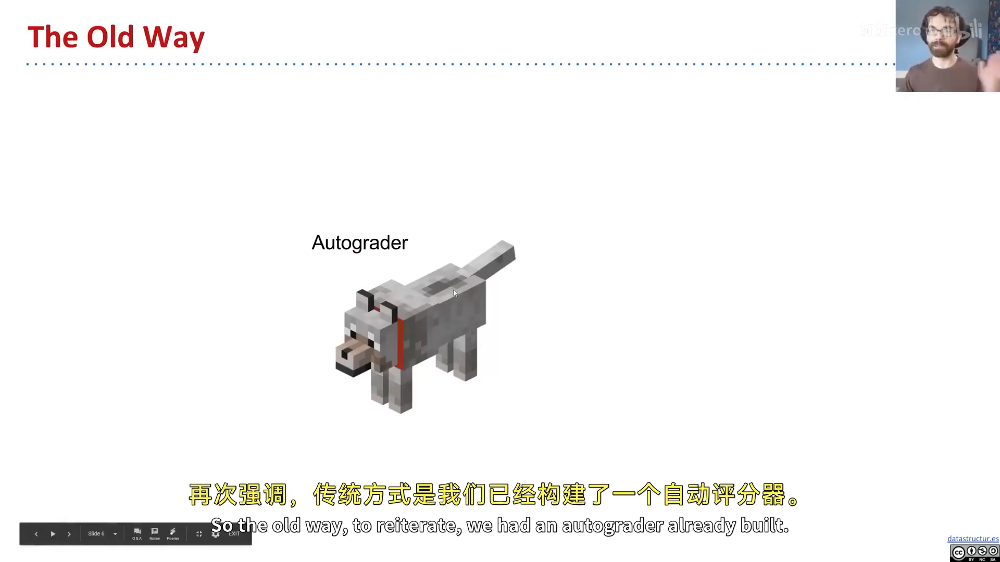
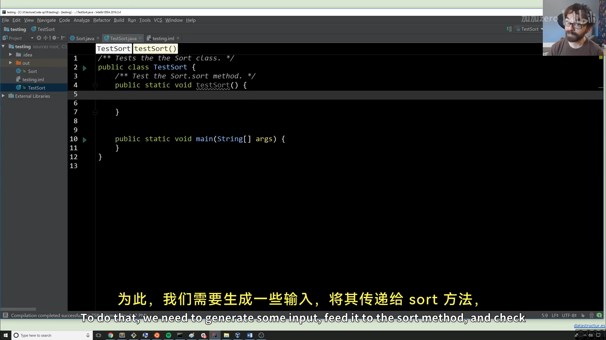
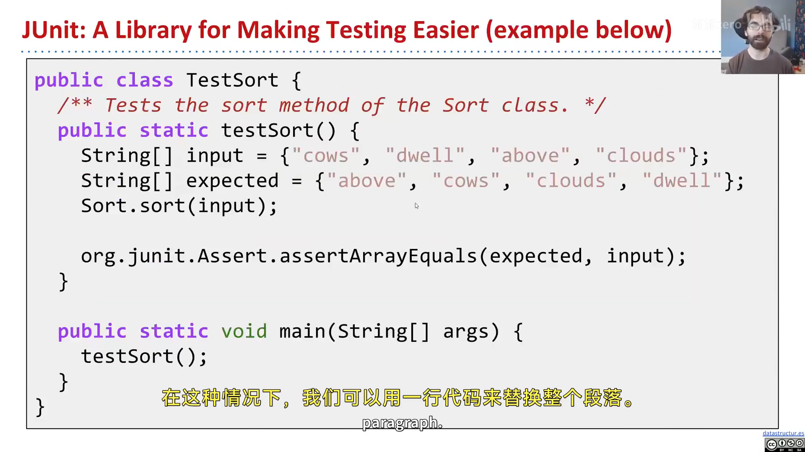
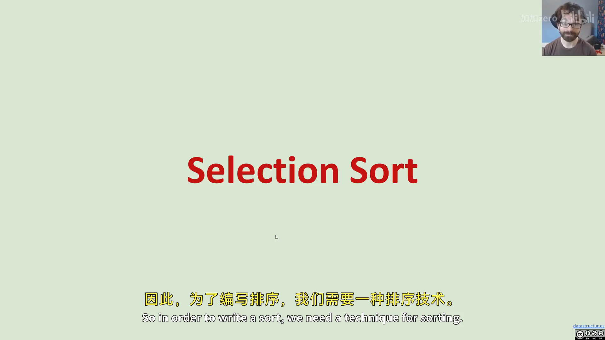
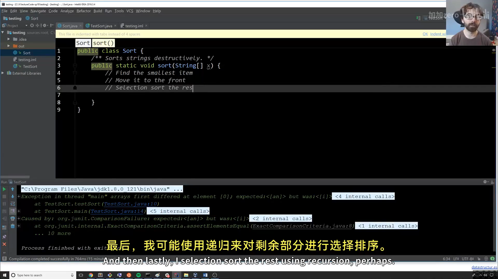
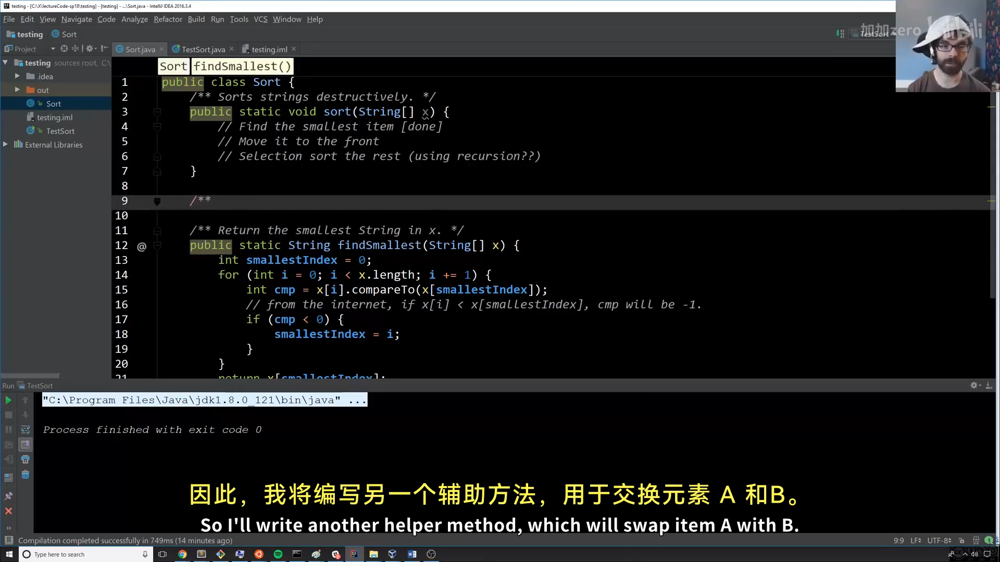
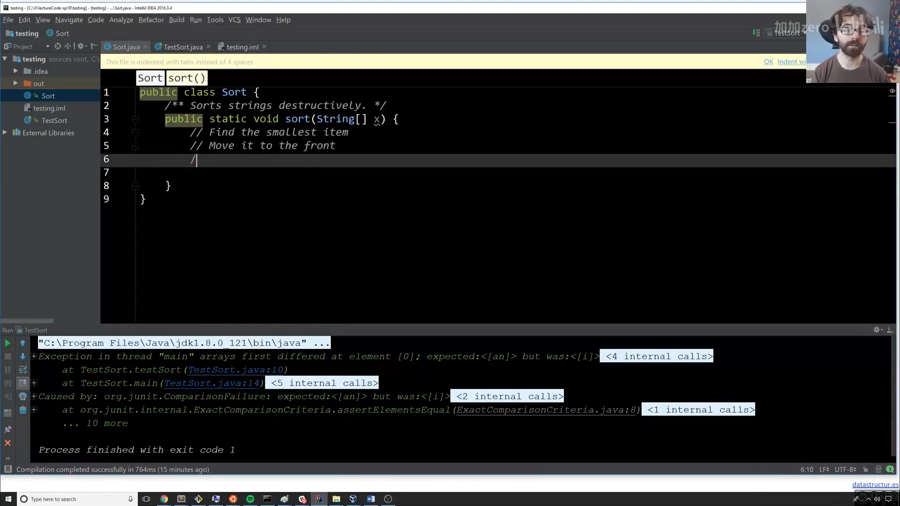

# CS61B 第 3 讲：测试与选择排序（Testing）

> **本电子书信息**
> - 来源视频：[【数据结构与算法 CS61B 2021】伯克利大学—中英字幕 p2 3_Testing](https://www.bilibili.com/video/BV1FSzNYpE7s/?p=3)
> - 课程讲义：[Hug61B · 3.1 A New Way](https://joshhug.gitbooks.io/hug61b/content/chap3/chap31.html)
> - 讲义版权：本课程全部材料由 **Josh Hug**（UC Berkeley CS61B）以 **Creative Commons 4.0 BY-NC-SA** 许可发布——可自由分享、演绎，但须署名 Josh Hug、以相同许可共享，且不得商用。
> - 本书由课堂录像字幕重构而成，术语以官方讲义为准；示意图为官方讲义原图，演示截图取自原视频。

中高级程序员最重要的技能之一，是**判断自己的代码是否正确**。这一讲我们学习如何自己写测试，并借机实现一个排序算法——**选择排序（Selection Sort）**。

---

## 一、一种新思路：先写测试，再写代码

课堂里，你靠自动评分器（autograder）获得信心；但现实中，测试要**你自己写**。本讲目标：写一个 `Sort` 类，提供 `sort(String[] x)` 方法，就地（破坏性地）排序字符串数组。

全新的思路是：**先写 `testSort()`，之后才动手写真正的排序代码**——测试先于实现。



---

## 二、Ad Hoc 测试（临时测试）

最简单直接的测试：造一个输入、调用 `sort`、检查输出对不对，错了就打印第一个不匹配的位置并终止：

```java
public class TestSort {
    public static void testSort() {
        String[] input = {"i", "have", "an", "egg"};
        String[] expected = {"an", "egg", "have", "i"};
        Sort.sort(input);
        for (int i = 0; i < input.length; i += 1) {
            if (!input[i].equals(expected[i])) {
                System.out.println("Mismatch in position " + i
                    + ", expected: " + expected[i] + ", but got: " + input[i] + ".");
                break;
            }
        }
    }
}
```

配合一个"啥也不做"的 `Sort.sort`，运行会得到：

```
Mismatch in position 0, expected: an, but got: i.
```

**能报错是好事**——说明测试在工作。你等于给自己造了一个"小游戏"：目标是改代码，让错误消失。很多人对"让测试通过"这件事几乎上瘾。

> **重要**：为什么不用 `input == expected` 直接比数组？因为 `==` 比较的是**内存盒子里的比特**（即地址），而不是数组里的值。所以要用循环逐项比（或用内置的 `java.util.Arrays.equals`）。



---

## 三、JUnit 测试

手写一堆循环和 print 很繁琐。`org.junit` 库能省掉大量工作：

```java
public static void testSort() {
    String[] input = {"i", "have", "an", "egg"};
    String[] expected = {"an", "egg", "have", "i"};
    Sort.sort(input);
    org.junit.Assert.assertArrayEquals(expected, input);
}
```

一行断言搞定，出错时会告诉我们第一个不同的位置。配合"啥也不做"的 `Sort.sort`，会得到：

```
arrays first differed at element [0]; expected:<[an]> but was:<[i]>
```

虽然输出比 ad hoc 测试难看一点，但写起来简单得多（本章末尾会讲如何让它更好看）。



---

## 四、选择排序（Selection Sort）

最简单的排序算法之一，三步：

1. **找到最小的项**；
2. **把它移到最前面**；
3. 对剩下的 N-1 项**递归地选择排序**（不再碰最前面的项）。

以 `{6, 3, 7, 2, 8, 1}` 为例：最小的 `1` 与最前的 `6` **交换**，得 `{1, 3, 7, 2, 8, 6}`；再在剩下部分找最小 `2`，与 `3` 交换，得 `{1, 2, 7, 3, 8, 6}`……依次得到 `{1,2,3,7,8,6}` → `{1,2,3,6,8,7}` → `{1,2,3,6,7,8}`。



> **编者说明**：把最小项移到前面有两种方式——"插入并整体后移"（低效）和"直接交换"（高效）。选择排序用的是后者。

对应到代码，先写几个注释当"路线图"：

```java
public class Sort {
    /** Sorts strings destructively. */
    public static void sort(String[] x) {
        // find the smallest item
        // move it to the front
        // selection sort the rest (using recursion?)
    }
}
```

---

## 五、findSmallest：找最小项

先写 `findSmallest` 的测试（照例，测试先于实现）：

```java
public static void testFindSmallest() {
    String[] input = {"i", "have", "an", "egg"};
    String expected = "an";
    String actual = Sort.findSmallest(input);
    org.junit.Assert.assertEquals(expected, actual);
}
```

真正实现时有个坑：字符串不能像数字那样用 `<` 比较。新手可能写出 `if (x[i] < smallest)`，这会导致编译错误。正确做法是用 `compareTo`：

```java
public static String findSmallest(String[] x) {
    String smallest = x[0];
    for (int i = 0; i < x.length; i += 1) {
        int cmp = x[i].compareTo(smallest);
        if (cmp < 0) {          // x[i] 字典序更小
            smallest = x[i];
        }
    }
    return smallest;
}
```

`compareTo` 返回负数表示"更小"、0 表示相等、正数表示"更大"。注意 Josh 在讲义里用了 `@source` 标注注明"字符串比较参考了某链接"——这是给正式选课学生的引用规范。



---

## 六、swap：交换两个元素

下一步是"交换"操作，同样先写测试再实现：

```java
public static void swap(String[] x, int a, int b) {
    String temp = x[a];
    x[a] = x[b];
    x[b] = temp;
}
```

用临时变量 `temp` 中转，这是交换两个变量的经典三步。（Josh 在课上先写了个带 bug 的版本——把 `swap` 参数错写成了字符串而非索引——测试立刻暴露了问题，这正是"测试先行"的价值。）



---

## 七、递归地排序剩余部分

把 `findSmallest` + `swap` + 递归组合起来，就得到完整的选择排序：

```java
public static void sort(String[] x) {
    sort(x, 0);          // 从下标 0 开始排
}

private static void sort(String[] x, int start) {
    if (start == x.length) {
        return;                        // 基本情况：排完了
    }
    int smallestIndex = findSmallestIndex(x, start);  // 在 [start, ...] 里找最小
    swap(x, start, smallestIndex);                    // 换到最前
    sort(x, start + 1);                               // 递归排剩下的
}
```

- **基本情况**：`start == x.length`，没有可排的了；
- **递归情况**：把 `[start, ...]` 里的最小项换到 `start` 位置，再递归排 `start+1` 之后的部分。



---

## 附：官方参考与延伸阅读

- **本讲讲义**（3.1 A New Way）：<https://joshhug.gitbooks.io/hug61b/content/chap3/chap31.html>
- **字符串比较参考**（compareTo）：<https://goo.gl/a7yBU5>
- **JUnit 官方文档**：<https://junit.org/junit4/>
- **`java.util.Arrays.equals`**：Oracle 官方文档

---

> **版权与许可**：本电子书中的课堂讲解内容重构自 Josh Hug（UC Berkeley）CS61B 课程录像；课程全部材料依据 **Creative Commons 4.0 BY-NC-SA** 许可发布。请在使用时署名 Josh Hug、以相同许可共享，且不得用于商业用途。书中示意图来自官方讲义原图，演示截图取自原视频，相应权利归原作者与视频权利人所有。
