# CS61B 第 4 讲：引用、递归与列表（References, Recursion, and Lists）

> **本电子书信息**
> - 来源视频：[【数据结构与算法 CS61B 2021】伯克利大学—中英字幕 p04 p3 4_References, Recursion, and Lists](https://www.bilibili.com/video/BV1FSzNYpE7s/?p=4)
> - 课程讲义：[Hug61B · 2.1 Mystery of the Walrus](https://joshhug.gitbooks.io/hug61b/content/chap2/chap21.html)
> - 讲义版权：本课程全部材料由 **Josh Hug**（UC Berkeley CS61B）以 **Creative Commons 4.0 BY-NC-SA** 许可发布——可自由分享、演绎，但须署名 Josh Hug、以相同许可共享，且不得商用。
> - 本书由课堂录像字幕重构而成，术语以官方讲义为准；文中"盒子与指针"示意图为官方讲义原图，演示过程图截取自视频。

本讲围绕一个看似简单的问题展开：**为什么修改引用类型的对象会"牵一发而动全身"，而基本类型却互不影响？** 沿着这条线索，Josh Hug 逐步引出内存模型、等号的黄金法则、引用类型、按值传递，并最终带领我们用递归与迭代从零实现一个链表 `IntList`。

---

## 一、开场：海象之谜（The Mystery of the Walrus）

本讲从一个谜题开始。它对理解"如何构建一个列表"至关重要——先不要急着往下看答案，试着凭直觉判断。

### 谜题一：海象

```java
Walrus a = new Walrus(1000, 8.3);
Walrus b;
b = a;
b.weight = 5;
System.out.println(a);
System.out.println(b);
```

问题：把 `b` 赋值为 `a` 之后，修改 `b.weight`，**会不会影响 `a`**？

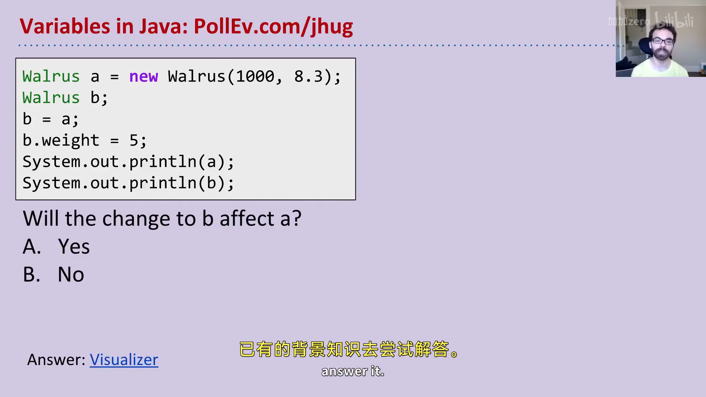

### 谜题二：整数

```java
int x = 5;
int y;
y = x;
x = 2;
System.out.println("x is: " + x);
System.out.println("y is: " + y);
```

问题：修改 `x`，**会不会影响 `y`**？

### 答案

- **海象之谜**：答案是**会**。修改 `b.weight` 会同时改变 `a` 与 `b`——尽管 `a` 最初被设置为 1000。
- **整数之谜**：答案是**不会**。`x = 2` 之后，`y` 仍然是 5。

在可视化器里运行第一段代码可以直观看到：创建海象 `a` 之后，当执行 `b = a`，画面上出现**两个箭头指向同一只海象**。于是 `b.weight` 改变的是那唯一一只海象，打印出来两者自然相同。而整数的情况则不同：`x` 和 `y` 是**两个完全不同的盒子**，`x = 2` 只改写 `x` 所在的盒子，`y` 的盒子纹丝不动。

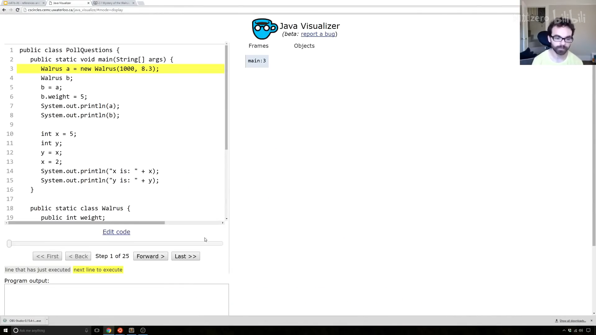

这就是 Josh Hug 所称的**海象之谜**。要真正理解"为什么海象和整数的行为不同"，必须先了解计算机如何存储信息。

---

## 二、内存与比特（Bits）

电脑里存储的任何信息——无论是原子的排列，还是某种神秘晶体——最终都以**一串 0 和 1** 编码。例如：

| 信息 | 典型编码 |
|---|---|
| 数字 `72` | `01001000` |
| 数字 `205.75` | `01000011 01001101 11000000 00000000` |
| 字母 `H` | `01001000`（与 72 相同！） |
| 布尔值 `true` | `00000001` |

本课程不会深究具体二进制表示（那是后续课程 CS61C 的内容），但值得注意一个耐人寻味的事实：**`72` 和字母 `H` 存储的都是 `01001000`**。那么一段 Java 代码如何知道该把这串比特解读成数字还是字母？

答案是**类型（type）**。看这段代码：

```java
char c = 'H';
int x = c;
System.out.println(c);  // H
System.out.println(x);  // 72
```

`c` 和 `x` 里存着几乎相同的比特，但 Java 解释器根据变量的类型对它们做不同解读：`char` 类型把它当作字母 `H`，`int` 类型把它当作数字 `72`。

Java 共有 **8 个基本类型（primitive types）**：`byte`、`short`、`int`、`long`、`float`、`double`、`boolean`、`char`。其中 `short` 和 `float` 在本课程中基本用不到，其余几种会随着课程推进逐个讨论。

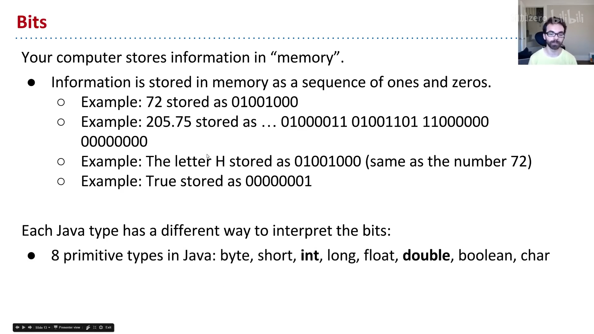

---

## 三、变量声明与盒子记法

### 声明变量 = 分配一个"盒子"

可以把电脑想象成拥有海量内存比特，每个比特都有唯一地址。当你声明一个特定类型的变量时，Java 会找一块**恰好够放该类型**的连续比特。例如：

- 声明 `int`，得到 32 比特；
- 声明 `double`，得到 64 比特。

为方便叙述，我们把这样一块内存称作一个**"盒子"（box）**。同时，Java 解释器会在内部维护一张表，把变量名映射到盒子的第一个比特的地址。执行下面两行：

```java
int x;
double y;
```

就得到两个盒子（32 位与 64 位）：

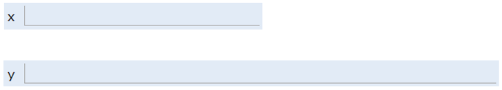

一个重要特性：**Java 不会告诉你盒子的确切位置**（你无法得知 `x` 在 352 号比特）。这是与 C 这类语言的关键区别——C 允许你直接索取某块数据的精确地址。Java 隐藏内存地址是一种权衡：少了控制权，也因此避开了大量极易出错的坑。正如 Donald Knuth 的名言："**过早的优化是万恶之源**。"（顺带一个贴切的类比：你无法直接控制自己的心跳——这限制了你对某些场景的优化，但也避免了"不小心把心跳关掉"这种蠢事。）

另一个细节：声明变量时，Java **不会**往盒子里写入任何默认值。因此在你用 `=` 给盒子填上比特之前，编译器不允许使用该变量（打印 `x` 或 `y` 会报错）。

而一旦赋值：

```java
x = -1431195969;
y = 567213.112;
```

盒子就被填入对应数字的比特：

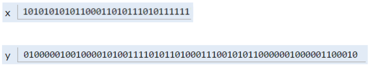

### 简化盒子记法

直接用二进制写盒子内容虽然精确，却极难读。于是本课程引入**简化盒子记法（simplified box notation）**：盒子内容改用人类可读的符号写出，而不是二进制。上述赋值后，环境可表示为：

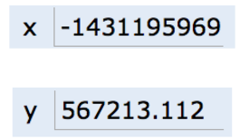

这套记法与课程所用的 Java 可视化器保持一致，将在全课程中反复使用。

---

## 四、等号的黄金法则（GRoE）

有了简化盒子记法，海象之谜终于可以被解开。谜底浓缩成一句话——**等号的黄金法则（Golden Rule of Equals, GRoE）**：

> 当你写 `y = x` 时，你是在告诉 Java 解释器：**把 `x` 盒子里的比特原样复制到 `y` 盒子里。**

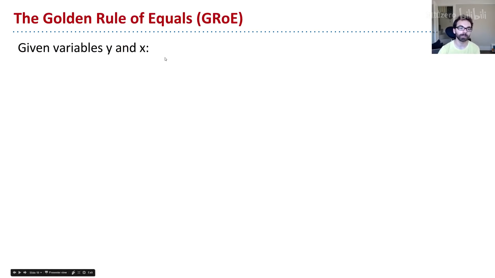

回到整数之谜：

```java
int x = 5;
int y;
y = x;   // 把 x 盒子里的比特（数字 5）复制到 y 盒子
x = 2;   // 把 x 盒子的内容改成数字 2，y 盒子不变
```

- `int x = 5`：得到一个装数字 5 的盒子；
- `int y`：得到另一个（暂未画内容的）盒子；
- `y = x`：把 `x` 里的比特复制进 `y`；
- `x = 2`：GRoE 说的是"把这个盒子填成 2"——只改 `x` 盒子，`y` 不受影响。

这就是整数之谜的答案：**`x` 和 `y` 是两个独立盒子，赋值只是复制比特，并不建立任何"联动"。**

这条法则对 Java 里**任何** `=` 赋值都成立，它也是后面理解一切引用行为、乃至所有数据结构效率的根基。

---

## 五、引用类型（Reference Types）

前面提到 8 个基本类型。**除此之外的一切——包括数组——都不是基本类型，而是引用类型（reference type）**，如 `Planet`、`Walrus`、`Dog`。

### 对象实例化：`new` 做了什么

当我们用 `new` 实例化一个对象（如 `new Walrus(1000, 8.3)`）时，Java 会为类的每个实例变量分配盒子并填默认值，随后构造函数（通常）再把这些盒子填成其他值。以海象类为例：

```java
public static class Walrus {
    public int weight;
    public double tuskSize;

    public Walrus(int w, double ts) {
        weight = w;
        tuskSize = ts;
    }
}
```

执行 `new Walrus(1000, 8.3)` 会得到一个由两个盒子（32 位 + 64 位，共 96 位）组成的海象：上面的盒子装重量 `1000`，下面的盒子装獠牙大小 `8.3`。

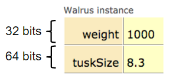

> **编者说明**：真实 Java 实现里，对象还有额外的元数据开销（所以一只海象不止 96 位），这里忽略不计，不影响本课程的理解。

`new` 关键字最有趣的地方在于它的**返回值**。类比：你到田里埋下宝藏，光埋没用，还必须**报告宝藏埋在哪里**，否则再也没人能找回它。`new` 正是这样——它在内存里为海象找到家之后，会**喊出这段内存的地址**（一串比特），作为返回值。

### 引用变量的声明：64 位的"地址盒子"

声明任意引用类型变量（海象、狗、行星、数组……），Java 分配的盒子**一律是 64 位**，与对象类型无关。这乍看荒谬：一只海象要 96 位，怎么一个变量只有 64 位？

谜底在于：**这 64 位的盒子里装的不是海象的数据，而是海象在内存中的地址。** 例如：

```java
Walrus someWalrus;
someWalrus = new Walrus(1000, 8.3);
```

第一行创建 64 位盒子；第二行由 `new` 返回地址，按 GRoE 复制进 `someWalrus` 盒子。假设海象的 `weight` 从比特 `5051956592385990207` 开始存放，那么 `someWalrus` 盒子里存的就是这个 64 位地址：

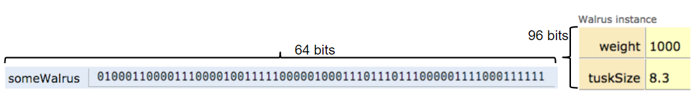

引用变量也可以赋特殊值 `null`，即全零：

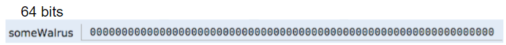

### 盒子与指针表示法

和之前一样，直接看一串 64 位地址毫无教育意义，于是我们引入**盒子与指针表示法（box and pointer notation）**：

- 地址为全零 → 写 `null`；
- 非零地址 → 画一个**箭头**，指向它所指的对象实例。

上面两例分别表示为：

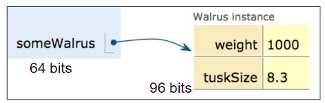

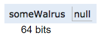

> **小结**：本课程后续画图时，每个变量都是一个带标签的小盒子；基本类型的值直接写在盒子里（如 `5`、`3.0`），引用类型则画箭头指向对象。这套记法是理解所有数据结构的关键。

---

## 六、解开海象之谜

现在终于可以完整、彻底地解开海象之谜。核心代码：

```java
Walrus a = new Walrus(1000, 8.3);
Walrus b;
b = a;
```

**第一步**，`a = new Walrus(1000, 8.3)`：`new` 找到 96 位内存存放海象并喊出地址，`a` 盒子记录这个地址（画成箭头）：

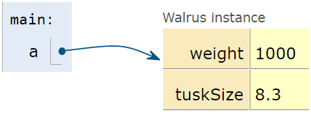

**第二步**，`Walrus b`：创建一个 64 位盒子。此时 `b` **未被定义**——既不是 null，也不是任何值，只是"什么都没有"：

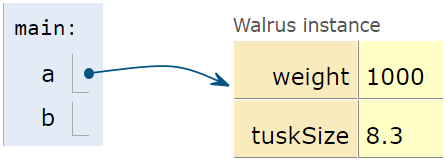

**第三步**，`b = a`：按 GRoE，把 `a` 盒子里的 64 位比特**原样复制**到 `b` 盒子。用视觉隐喻说，就是把 `a` 里的箭头复制一份给 `b`：

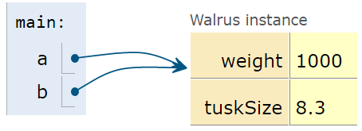

仅此而已，没有任何更复杂的魔法。于是 `b.weight` 会"跟着箭头走"，找到与 `a` 相同的海象——这就是海象之谜的完整答案。

---

## 七、参数传递：按值传递

GRoE 不仅适用于赋值，**同样适用于函数传参**——当你把参数传给函数时，本质仍然是复制比特。复制比特这件事通常被称为**按值传递（pass by value）**，而 Java **永远按值传递**。

以平均值为例：

```java
public static double average(double a, double b) {
    return (a + b) / 2;
}

public static void main(String[] args) {
    double x = 5.5;
    double y = 10.5;
    double avg = average(x, y);
}
```

`main` 执行前两行后，得到两个盒子 `x = 5.5`、`y = 10.5`：

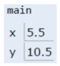

调用 `average(x, y)` 时，`average` 函数拥有**自己的作用域**，里面有全新的 `a`、`b` 两个盒子，`x`、`y` 的比特被**复制**进去：

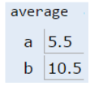

如果 `average` 里修改 `a`，`main` 里的 `x` 完全不变——因为 GRoE 说，你只是在给 `a` 这个盒子填入新比特。**没有任何反向箭头指回 `main`。**

### 练习：doStuff

```java
public class PassByValueFigure {
    public static void main(String[] args) {
        Walrus walrus = new Walrus(3500, 10.5);
        int x = 9;
        doStuff(walrus, x);
        System.out.println(walrus);  // ?
        System.out.println(x);       // ?
    }

    public static void doStuff(Walrus W, int x) {
        W.weight = W.weight - 100;
        x = x - 5;
    }
}
```

调用 `doStuff` 后，`walrus` 和 `x` 分别是什么？——只需 GRoE 一条规则即可求解。

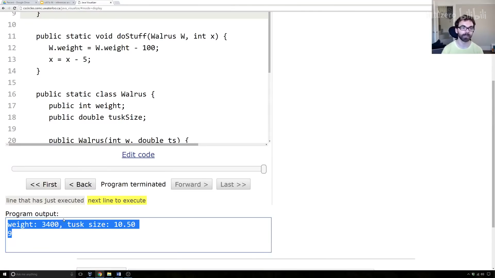

**解答思路**：`doStuff` 有自己的作用域，参数 `W` 和 `x` 是复制来的比特。`W` 盒子里复制的是**海象的地址**，所以 `W` 与 `walrus` 两个箭头指向同一只海象——`W.weight -= 100` 会把那只海象减重 100，`main` 里的 `walrus` 自然"变轻了"。而 `x` 盒子里复制的是**数字 9 本身**（不是 9 的地址），`x = x - 5` 只改 `doStuff` 里这个局部 `x`，不会回流到 `main`。所以最终：`walrus.weight == 3400`，而 `main` 里的 `x` 仍是 `9`。

> 这里有一个极其微妙但重要的区别：**引用参数复制的是"地址"，基本类型参数复制的是"值本身"。**

---

## 八、数组也是引用类型

数组同样是对象，和行星、海象、狗一样，通常用 `new` 实例化。把数组的声明、实例化、赋值拆开看：

```java
int[] a;                          // 声明：64 位盒子，只能存数组地址
a = new int[]{0, 1, 2, 95, 4};    // 实例化 + 赋值
```

- **声明** `int[] a` 创建一个 64 位盒子，且编译器只允许往里面存数组地址，目前还没有实际对象；
- **实例化** `new int[]{...}` 创建 5 个各 32 位的盒子，分别放入 `0、1、2、95、4`，`new` 返回这个数组对象的地址；
- 若地址无人接收（"落在聋子的耳朵上"），对象创建后立刻不可用——所以我们通常三步合一完成赋值。

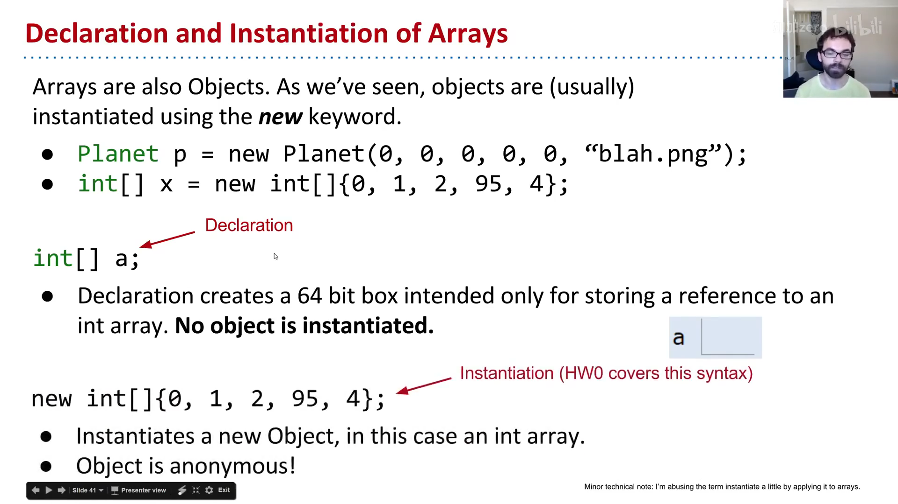

**对象可以被"丢失"**：如果某个对象的地址只存在 `a` 一个盒子里，那么 `a = new int[]{...}` 或 `a = null` 之后，就再也没有任何地方保存那个旧对象的地址，它将永远无法被访问。这不是坏事——很快我们构建列表时，会主动希望丢弃对旧对象的引用，由垃圾回收器回收。

---

## 九、IntList：从零构建链表

至此，我们终于可以动手构建一个列表。列表与数组的核心区别是：**列表可以任意增长**，而 Java 数组大小固定。

我们的列表类 `IntList` 只含两个成员：

```java
public class IntList {
    public int first;      // 一个整数
    public IntList rest;   // 指向另一个列表的地址（指针）

    public IntList(int f, IntList r) {
        first = f;
        rest = r;
    }
}
```

- `first`：本节点存的整数；
- `rest`：指向"剩余列表"的指针。若 `rest == null`，说明这是最后一个节点。

用盒子与指针表示，一个 `5 → 10 → 15` 的链表长这样：

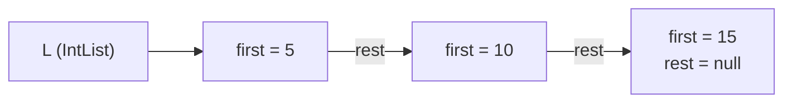

### 正向构建（啰嗦但直观）

```java
IntList L = new IntList(5, null);
L.rest = new IntList(10, null);
L.rest.rest = new IntList(15, null);
```

逐步可视化可以看到：先有 `first=5, rest=null` 的列表 `L`；然后 `L.rest` 成为 `first=10, rest=null` 的新节点；最后 `L.rest.rest` 成为 `first=15, rest=null` 的节点。

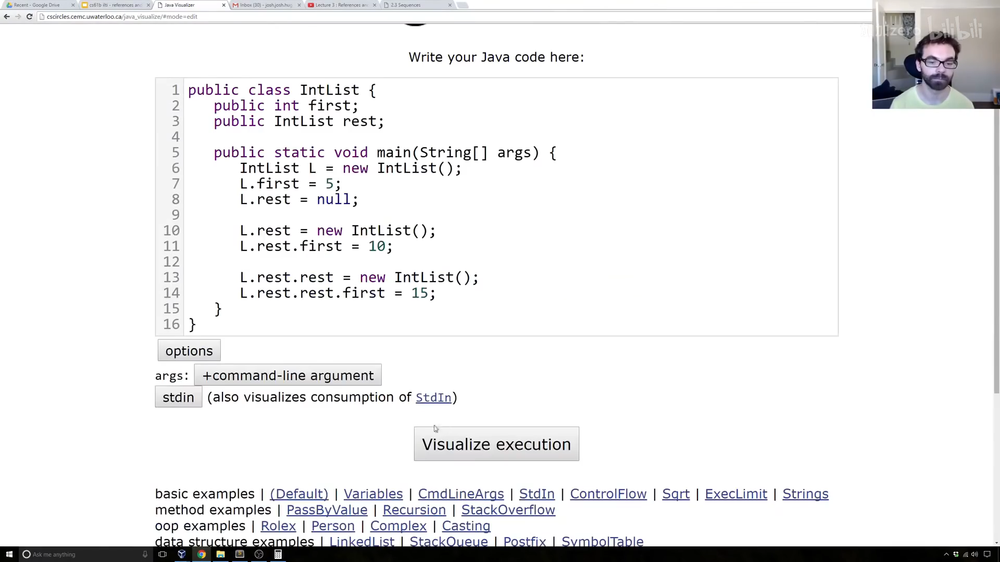

### 反向构建（更简洁）

先加构造函数 `IntList(int f, IntList r)`，再从尾部往前搭：

```java
IntList L = new IntList(15, null);
L = new IntList(10, L);
L = new IntList(5, L);
```

每一步都"新建一个节点，把旧列表挂到它的 `rest` 上"，最终得到 `5 → 10 → 15`。

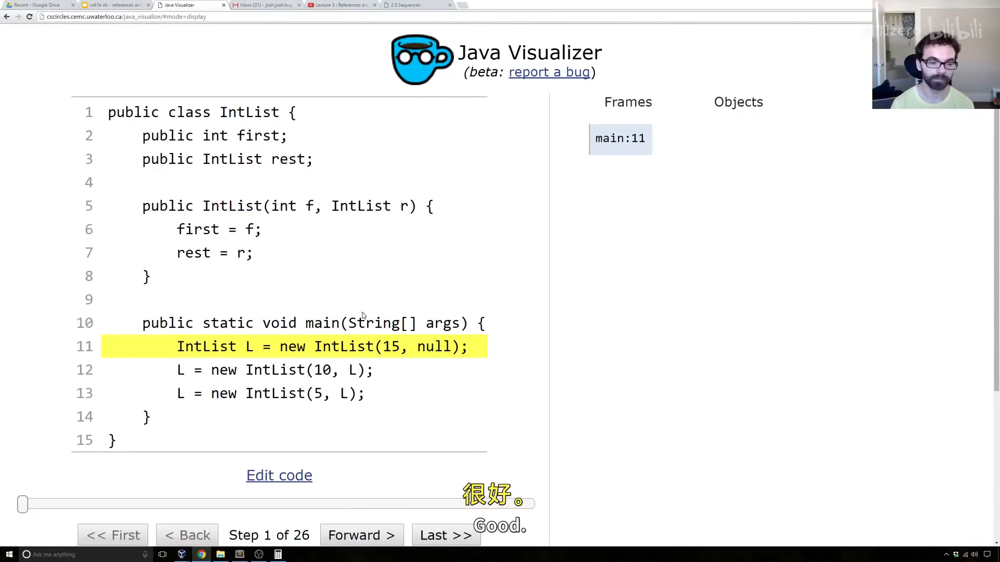

到这里，`IntList` 在技术上已经能做列表所需的一切操作，但用起来相当别扭——比如取第 `i` 个元素、询问列表大小都让人抓狂。于是接下来为它添加辅助方法。

---

## 十、size 与 iterativeSize

我们要加一个 `size()` 方法：调用 `L.size()` 返回列表元素个数（类似 Python 的 `len`）。

### 递归版 size

递归方法必须有一个**基本情况（base case）**。这里最自然的基况是 `rest == null`——此时列表只有一个元素，返回 `1`：

```java
/** 用递归返回列表大小 */
public int size() {
    if (rest == null) {
        return 1;
    }
    return 1 + this.rest.size();
}
```

- 若 `rest == null`，返回 `1`；
- 否则，本节点贡献 `1`，再加上"剩余列表的大小"。

> **常见疑问**：为什么不写 `if (this == null) return 0;`？因为 `size()` 是在某个对象上被调用的（如 `L.size()`）——若 `L` 本身是 `null`，这一步就会抛空指针异常，根本到不了方法体。

在可视化器里逐步跟踪递归调用：`L` 先问自己的 `rest` 是否为 null——不是，于是"问朋友"`rest` 的大小再加一；一路问到最后一个节点，它回答"我的 `rest` 是 null，大小是 1"；返回值逐层回传 `1 → 2 → 3`。

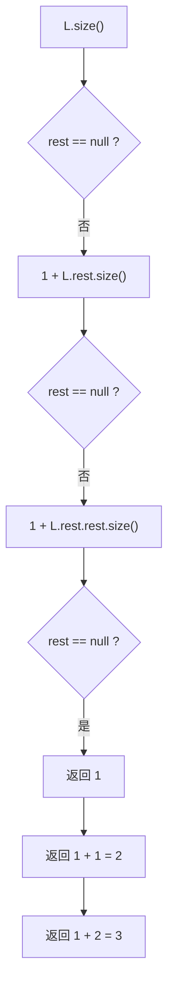

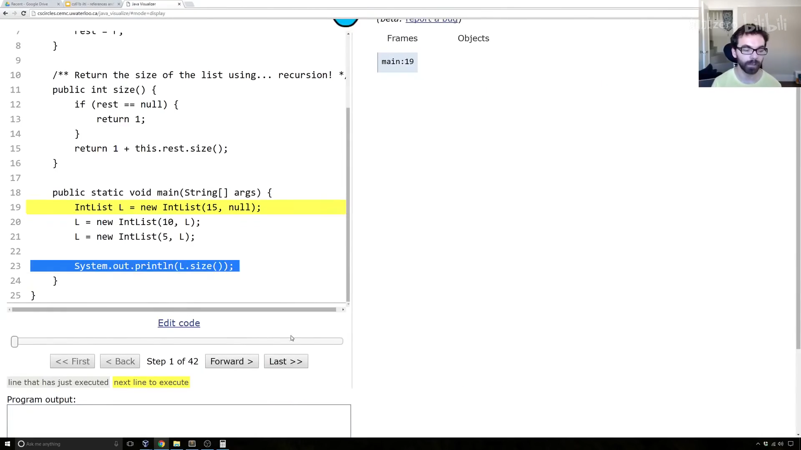

### 迭代版 iterativeSize

为了展示另一种模式，再写一个不用递归的版本。常见套路是引入一个指针变量 `p`，从 `this` 出发逐步前进：

```java
/** 用迭代（无递归）返回列表大小 */
public int iterativeSize() {
    IntList p = this;
    int totalSize = 0;
    while (p != null) {
        totalSize += 1;
        p = p.rest;
    }
    return totalSize;
}
```

`p` 这个名字提醒自己：它持有一个**指针**。之所以需要 `p`，是因为 Java 里不能给 `this` 重新赋值。循环每走一步计数加一、`p` 前进到下一个节点，直到 `p == null`。

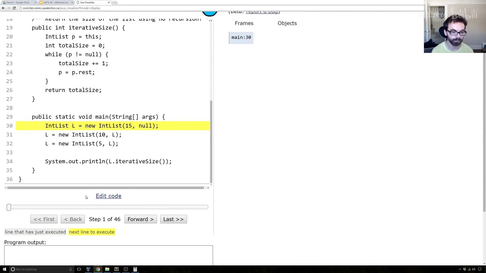

> **编者说明**：`iterativeSize` 里的 `while` 循环可以用 `if` 改写为递归，两者本质等价；视频中讲师采用的正是上述"指针前移"写法。

---

## 十一、get 方法

最后，添加 `get(int i)` 返回列表第 `i` 个元素（约定最前面的是第 0 项）。为了简单，假设调用者请求的索引确实存在（越界时崩溃也无妨）。

对 `5 → 10 → 15`：`L.get(0)` 返回 `5`，`L.get(1)` 返回 `10`，`L.get(2)` 返回 `15`。

用递归实现，基况是 **`i == 0`**——直接返回 `first`；否则把问题"甩"给 `rest`，询问它的第 `i - 1` 项：

```java
/** 返回列表第 i 项（最前为第 0 项） */
public int get(int i) {
    if (i == 0) {
        return first;
    }
    return rest.get(i - 1);
}
```

思路是：**我的第 `i` 项，就是我邻居（`rest`）的第 `i - 1` 项。** 例如 `L.get(1)` 等于 `L.rest.get(0)`，而 `rest.get(0)` 直接返回 `10`。测试：`get(0)` 得 5、`get(1)` 得 10、`get(2)` 得 15，越界请求则崩溃——符合预期。

注意，这样写出来的 `get` 是**线性时间**：若列表有 100 万个元素，取最后一项比短列表慢得多。后续课程会介绍能避免这个问题的列表实现（如 `SLList`、`AList`）。

---

## 附：官方参考与延伸阅读

- **本讲讲义**（Mystery of the Walrus）：<https://joshhug.gitbooks.io/hug61b/content/chap2/chap21.html>
- **Java 可视化器**（本讲演示全程使用的工具）：<http://cscircles.cemc.uwaterloo.ca/java_visualize/>
- **整数表示**（二进制补码）：<https://en.wikipedia.org/wiki/Two%27s_complement>
- **浮点表示**（IEEE 754）：<https://en.wikipedia.org/wiki/IEEE_floating_point>
- **"过早优化是万恶之源"**（Knuth）：<http://www.informit.com/articles/article.aspx?p=2246428&seqNum=5>
- **内存隐藏避免的编程错误**：<http://www.informit.com/articles/article.aspx?p=2246428&seqNum=1>
- **The Law of the Broken Futon**（关于"半懂不懂"的代价）：<https://mathwithbaddrawings.com/2015/04/08/the-math-ceiling-wheres-your-cognitive-breaking-point/>
- **为什么不能在 Java 里重新给 this 赋值**：<https://stackoverflow.com/questions/23021377/reassign-this-in-java-class>
- **本讲后续练习**（未评分，`incrList` / `dinkList`）：见课程 lectureCode 仓库的 `lists` 练习目录。

---

> **版权与许可**：本电子书中的课堂讲解内容重构自 Josh Hug（UC Berkeley）CS61B 课程录像；课程全部材料依据 **Creative Commons 4.0 BY-NC-SA** 许可发布。请在使用时署名 Josh Hug、以相同许可共享，且不得用于商业用途。书中的示意图（盒子与指针图）来自官方讲义原图，演示过程截图来自原视频，相应权利归原作者与视频权利人所有。
