# CS61B 第 5 讲：SLList、嵌套类与哨兵节点（SLLists, Nested Classes, Sentinel Nodes）

> **本电子书信息**
> - 来源视频：[【数据结构与算法 CS61B 2021】伯克利大学—中英字幕 p04 5_SLLists, Nested Classes, Sentinel Nodes](https://www.bilibili.com/video/BV1FSzNYpE7s/?p=5)
> - 课程讲义：[Hug61B · 2.2 The SLList](https://joshhug.gitbooks.io/hug61b/content/chap2/chap22.html)
> - 讲义版权：本课程全部材料由 **Josh Hug**（UC Berkeley CS61B）以 **Creative Commons 4.0 BY-NC-SA** 许可发布——可自由分享、演绎，但须署名 Josh Hug、以相同许可共享，且不得商用。
> - 本书由课堂录像字幕重构而成，术语以官方讲义为准；文中示意图为官方讲义原图，演示过程图截取自视频。

上一讲我们构建了 `IntList`，它在技术上能做列表能做的一切，但用起来别扭、代码难读难维护。究其原因，`IntList` 是一个**裸递归数据结构（naked recursive data structure）**：使用者必须深刻理解引用与递归，哪怕只是完成最简单的列表操作。本讲我们要给它"穿上衣服"，逐步把它改造成更接近现代语言中列表实现的新类 `SLList`。

---

## 一、改进一：重塑品牌（Rebranding）

`IntList` 的问题在于：它的递归结构"裸露"在外，谁都能直接摸到。在 Java 文化里，暴露裸递归结构是很奇怪的（在 Scheme 这类函数式语言里则司空见惯，但 Java 新手会被这种写法吓到）。

第一步看起来毫无进展：把上一讲的 `IntList` **重命名**并**删掉所有辅助方法**，得到 `IntNode`：

```java
public class IntNode {
    public int item;
    public IntNode next;

    public IntNode(int i, IntNode n) {
        item = i;
        next = n;
    }
}
```

- `first` → `item`，`rest` → `next`；
- 删除 `size`、`get` 等方法，只留下最纯粹的"一个整数 + 一个指向下一个节点的指针"。

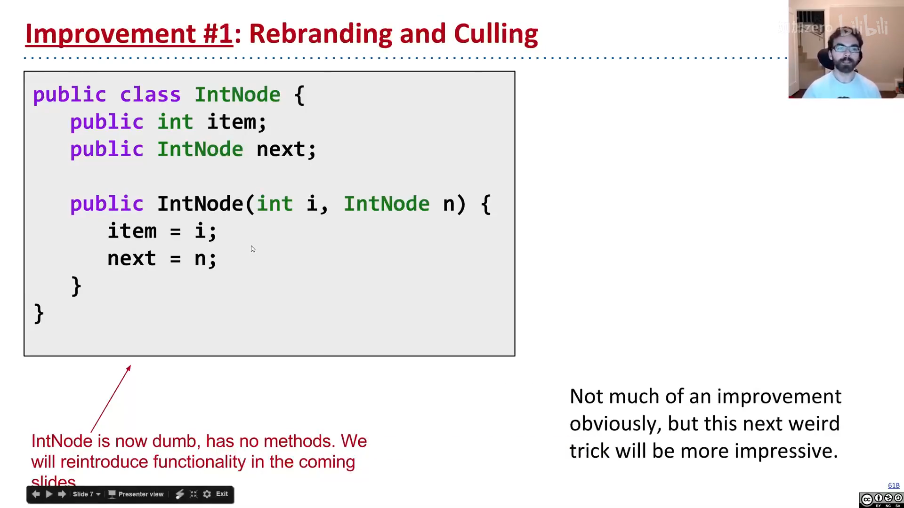

这一步没有带来任何功能改进，但它把"数据载体（节点）"和"用户交互界面"的概念区分开了——这是后续一切改进的基础。

---

## 二、改进二：官僚体制（Bureaucracy）

`IntNode` 用起来很难。于是我们再建一个独立的类 `SLList`，让**用户只与它打交道**：

```java
public class SLList {
    public IntNode first;

    public SLList(int x) {
        first = new IntNode(x, null);
    }
}
```

对比创建"单元素列表"的两种写法：

```java
IntList L1 = new IntList(5, null);   // 裸递归：必须手动填 null
SLList  L2 = new SLList(5);          // 有包装：null 细节被隐藏
```

`SLList` 把"存在一个 null 链接"这一细节藏了起来。它本质上是一个**中间人（middleman）**：用户不直接接触裸递归结构，而是通过 `SLList` 提供的方法来操作。

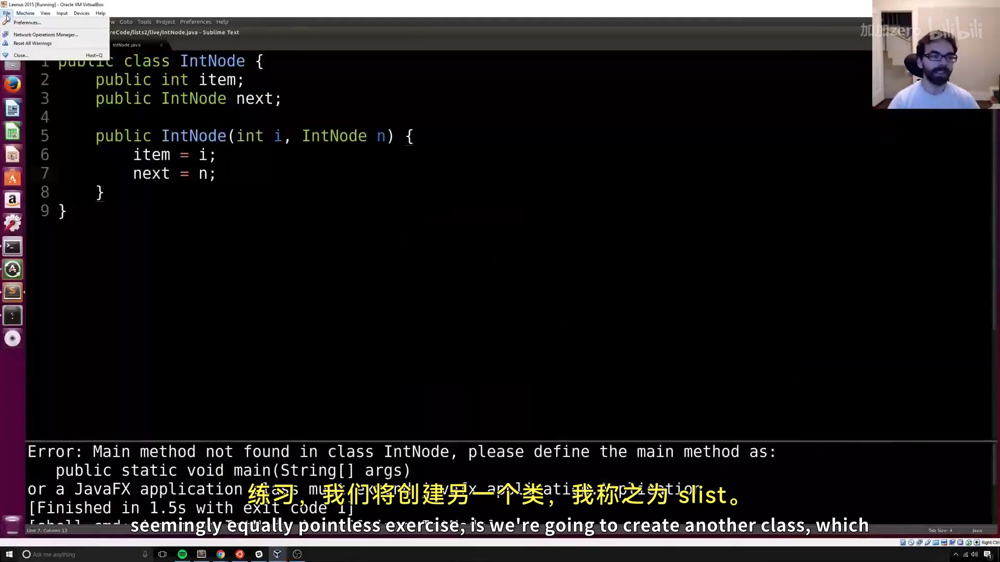

### addFirst 与 getFirst

加上两个热身方法：

```java
public void addFirst(int x) {
    first = new IntNode(x, first);   // 头部插入：新节点指到旧 first
}

public int getFirst() {
    return first.item;
}
```

用法对比：

```java
SLList L = new SLList(15);
L.addFirst(10);
L.addFirst(5);
int x = L.getFirst();    // 5
```

而裸递归的 `IntList` 等价写法是：

```java
IntList L = new IntList(15, null);
L = new IntList(10, L);
L = new IntList(5, L);
int x = L.first;         // 需要直接摸 first，且必须理解"反向构建"
```

两者对比（上为 `IntList`，下为 `SLList`）：

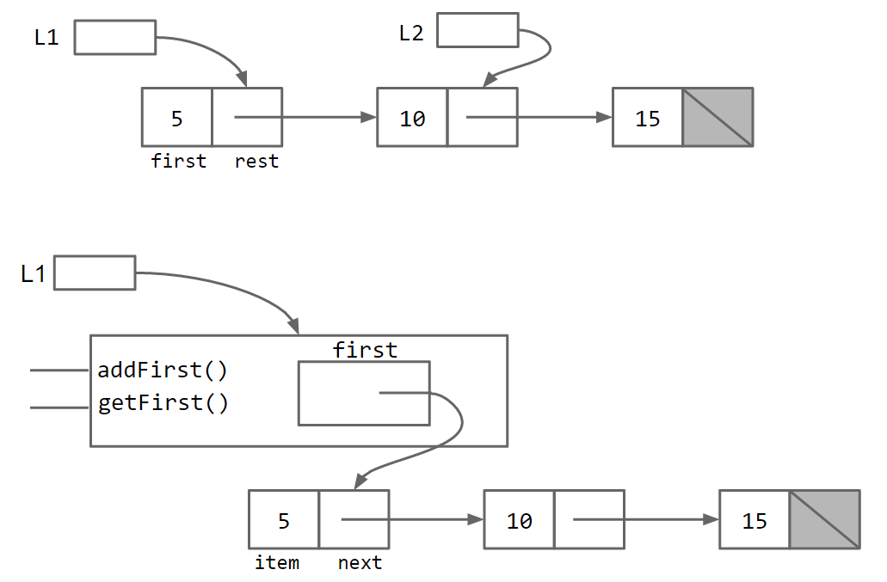

`SLList` 让代码读起来像普通 Java 惯例，新手也更容易上手。正如 Ovid 的典故所暗示的——"凡人不能直视神明而不死"，裸递归结构还是让 `SLList` 这个中间人来代为沟通为好。

---

## 三、改进三：公有与私有（Public vs. Private）

尽管有了 `SLList`，用户**技术上**仍能绕过它直接篡改内部结构。例如：

```java
SLList L = new SLList(15);
L.addFirst(10);
L.first.next.next = L.first.next;   // 直接摸裸结构，制造环
```

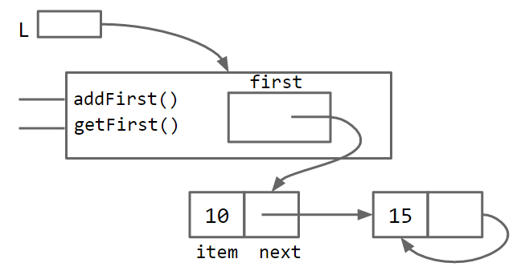

这会得到一个带**无限循环**的畸形列表。解决方法是把 `first` 声明为 `private`：

```java
public class SLList {
    private IntNode first;
    ...
}
```

`private` 成员只能被**同一个 `.java` 文件**里的代码访问。外部类（如 `SLLTroubleMaker`）再想摸 `first`，编译时就会报 `first has private access in SLList`。

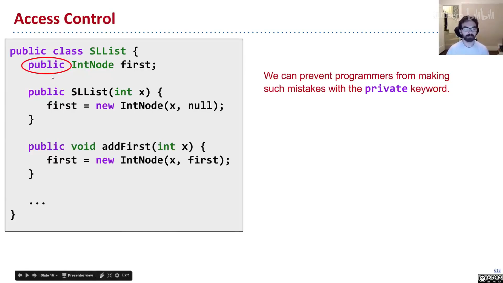

**为什么要限制访问？** 核心是**隐藏实现细节**：用户不需要知道有个 `first` 变量，更不该去动它——列表对用户来说应该是一个"神奇黑匣子"。

类比汽车：车有 `public` 的部分（油门、刹车、方向盘），车盖底下是 `private` 的细节（燃油喷射系统 / 电池电机）。不同车的私有细节千差万别，但所有油门踏板的**对外行为**都应一致；私有细节随你怎么改，用户都不会察觉。

> **金句**：当你把一个成员设为 `public`，你实际上在向全世界承诺——它的行为将**永远**保持现在这样。所以 `private` 意味着"可以随意改、没人依赖它"，`public` 意味着"一经发布、永久负责"。

---

## 四、改进四：嵌套类（Nested Classes）

`IntNode` 其实只是 `SLList` 故事里的"配角"，不该单独占一个 `.java` 文件。Java 允许把类声明嵌进另一个类里：

```java
public class SLList {
    public class IntNode {
        public int item;
        public IntNode next;
        public IntNode(int i, IntNode n) {
            item = i;
            next = n;
        }
    }

    private IntNode first;
    ...
}
```

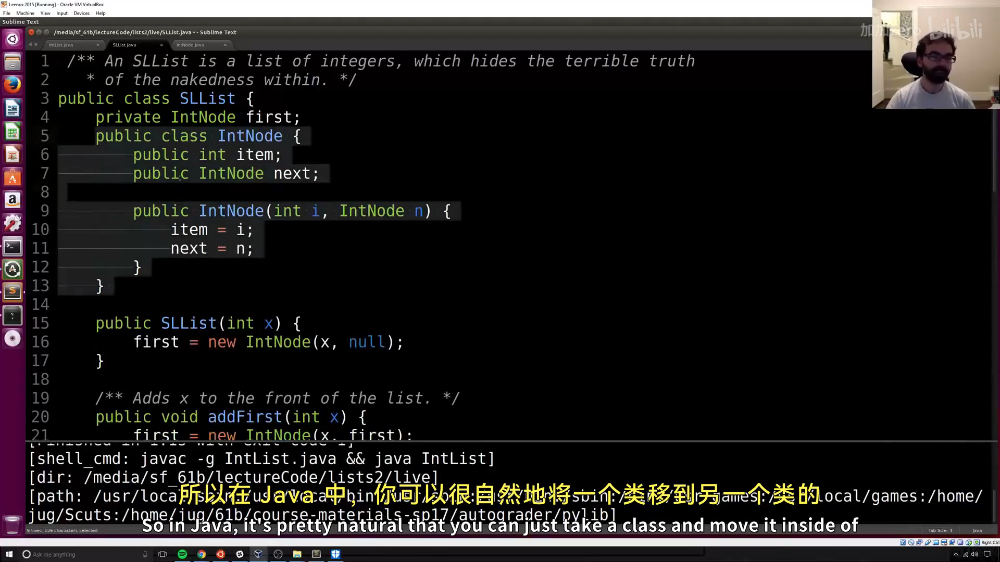

嵌套类**不影响性能**，只是让代码组织更清晰（详见 [Oracle 嵌套类文档](https://docs.oracle.com/javase/tutorial/java/javaOO/nested.html)）。

如果嵌套类**不使用**外部类的任何实例成员，就把它声明为 `static`：

```java
public static class IntNode { ... }
```

`static` 嵌套类无法访问外部类的 `first`、`addFirst` 等成员。好处是**节省一点内存**——每个 `IntNode` 不再需要持有"如何访问它的老板 `SLList`"的引用。经验法则：**如果嵌套类不用外部类的实例成员，就把它设为 static。**

---

## 五、addLast 与 size

为给后续改进提供动力，我们给 `SLList` 加上 `addLast`（加尾部）和 `size`（求大小）。

### addLast：迭代版

用指针变量 `p` 一路走到链表末尾：

```java
public void addLast(int x) {
    IntNode p = first;
    while (p.next != null) {
        p = p.next;         // 前进到末尾
    }
    p.next = new IntNode(x, null);
}
```

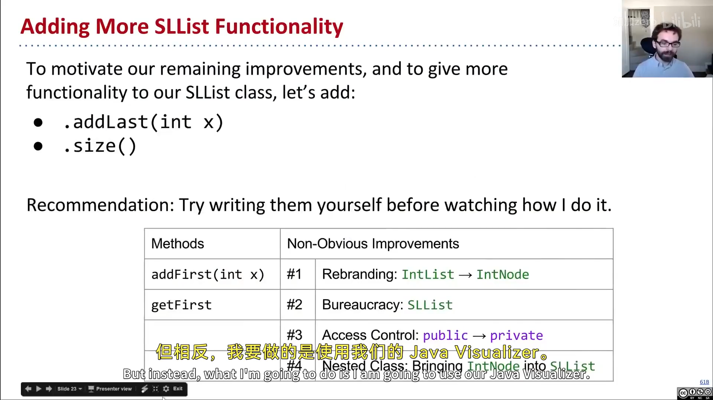

### size：递归版（"凡人的语言"与"神的语言"）

上一讲 `IntList.size()` 是 `return 1 + this.rest.size()`，因为 `IntList` 有 `rest`。但 `SLList` **没有** `rest` 变量——`SLList` 本身不是递归的。于是我们采用一个常见模式：写一个 `private static` 辅助方法，去"和底层裸递归结构对话"：

```java
/** 返回从 IntNode p 开始的列表大小 */
private static int size(IntNode p) {
    if (p.next == null) {
        return 1;
    }
    return 1 + size(p.next);
}

public int size() {
    return size(first);
}
```

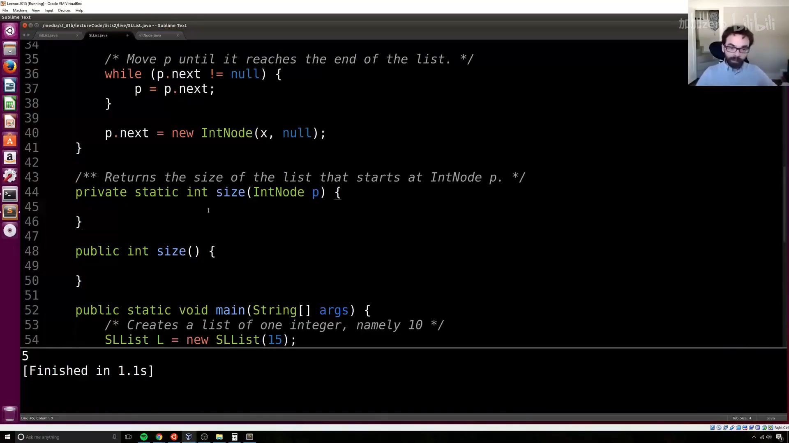

两个方法同名 `size` 但参数不同，这叫做**重载（overload）**。Josh 把这对方法称作：`public` 方法用"凡人的语言"说话，`private` 辅助方法用"神的语言"说话——这是处理"中间人类 + 裸递归底层"的经典套路，后续会反复出现。

---

## 六、改进五：缓存（Caching）

上面的 `size` 是**线性时间**：列表有 100 万个元素，就要走 100 万步。假设 size 处理 1000 个元素要 2 秒，那处理 100 万元素就要 2000 秒——不可接受。

解法是**缓存大小**：在 `SLList` 里加一个 `size` 变量，每次增删时顺手更新：

```java
public class SLList {
    private IntNode first;
    private int size;

    public SLList(int x) {
        first = new IntNode(x, null);
        size = 1;
    }

    public void addFirst(int x) {
        first = new IntNode(x, first);
        size += 1;
    }

    public int size() {
        return size;      // 无论列表多大，O(1)
    }
}
```

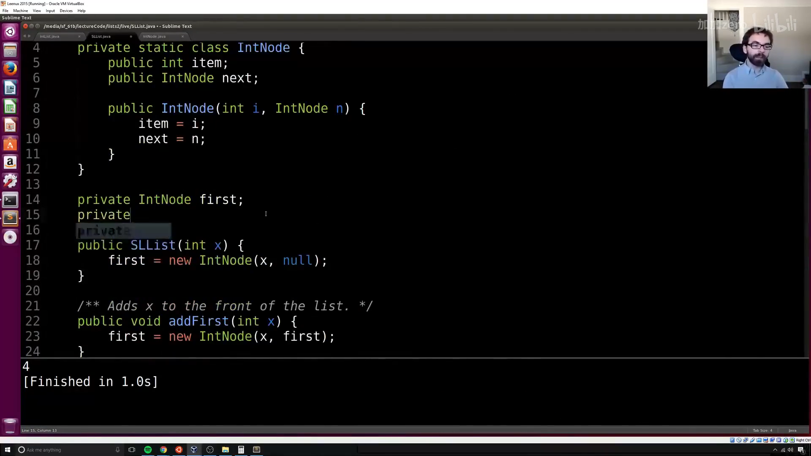

> **编者说明**：缓存（caching）= 把重要数据"放到一边"以加速后续检索。这不是免费的（`addFirst`/`addLast` 要额外 `size += 1`，还要多占一点内存），但代价微不足道，绝大多数情况下都是净收益。

这里还揭示出 `SLList`（中间人）的另一个天然优势：**它可以顺手存储整个列表的元数据**（size、max、min……）。裸递归结构做不到这么自然——你没法在链表上挂一个"全局"变量。

---

## 七、改进六：空列表与哨兵节点

### 空列表的 bug

很自然，我们想支持"空列表"：

```java
public SLList() {
    first = null;
    size = 0;
}
```

但 `addLast` 在空列表上会**崩溃**：`first` 是 `null`，`while (p.next != null)` 里访问 `p.next` 就抛空指针异常。

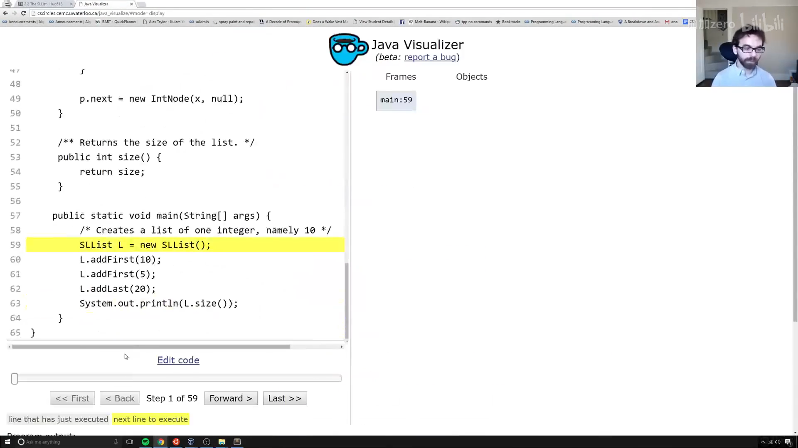

最直接的修法是加一个**特殊情况**：

```java
public void addLast(int x) {
    size += 1;
    if (first == null) {
        first = new IntNode(x, null);
        return;
    }
    IntNode p = first;
    while (p.next != null) p = p.next;
    p.next = new IntNode(x, null);
}
```

它有效，但"有特殊情况的代码很难推理"——人类工作记忆有限。链表这种简单结构特殊情况还少，换成树等复杂结构，特殊情况会爆炸式增长。我们要追求**一个一致的故事**。

### 哨兵节点（Sentinel Node）

更优雅的解法：**让所有 `SLList` 都"长得一样"，即使是空的**。做法是永远放一个**哨兵节点**（一个值无所谓的虚拟节点）在开头：

- 空列表：`sentinel.next == null`
- 含 5、10、15 的列表：`sentinel → 5 → 10 → 15`

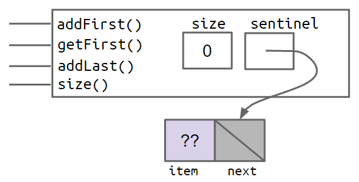

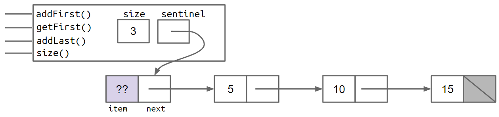

（图中淡紫色的 `??` 表示我们**不在乎**哨兵的值，随便填个 `-518273` 或 `63` 都行。）

于是 `addLast` 里那坨特殊情况代码被**整个删掉**：

```java
public void addLast(int x) {
    size += 1;
    IntNode p = sentinel;
    while (p.next != null) p = p.next;
    p.next = new IntNode(x, null);
}
```

关键改动：`first` 变量重命名为 `sentinel`，它**永远指向哨兵节点、永远不为 null**；真正的前端项（若存在）在 `sentinel.next.item`。

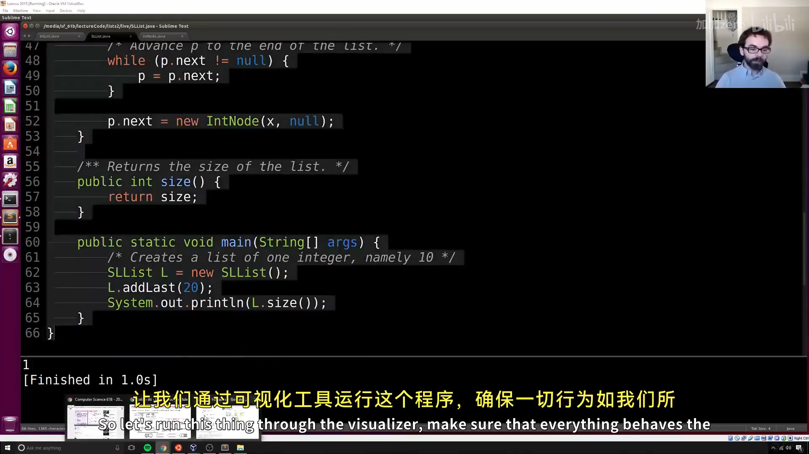

注意几个易错点（Josh 在课上现场演示过）：

- `addFirst` 不能写 `sentinel = new IntNode(x, sentinel)`（这会**重新分配哨兵**），而应写 `sentinel.next = new IntNode(x, sentinel.next)`——让新人插到队伍前面；
- `getFirst` 要返回 `sentinel.next.item`，**不是** `sentinel.item`——哨兵是"忠实伙伴"，它的意见永远不该被询问。

---

## 八、不变量（Invariants）

**不变量**是"只要你的代码没有 bug，就保证为真的、关于数据结构的事实"。带哨兵节点的 `SLList` 至少有这些不变量：

1. `sentinel` 引用**总是**指向一个哨兵节点；
2. 前端项（若存在）**总是**位于 `sentinel.next.item`；
3. `size` 变量**总是**等于已添加的元素总数。

不变量有两个用处：

- **方便推理**：写 `addLast` 时，你知道 `sentinel` 永远非空，就不用担心空值；
- **作为检查清单**：方法跑完后，所有不变量都应重新成立——把它们写在纸上（或写成代码注释），能帮你避免 bug。

---

## 小结

本讲把上一讲的 `IntList` 一步步改造成 `SLList`：重塑品牌 → 加中间人 → `private` 隐藏细节 → 嵌套类整理组织 → 缓存加速 `size` → 哨兵节点消除特殊情况 → 用不变量约束结构。`SLList` 相比裸递归列表的优势：用户看不到内部节点、更易用、`addFirst` 更高效、能避免误用、`size` 更快，还能自然表示空列表。

下一讲将解决 `SLList` 的两个遗留限制（只能存整数、`addLast` 仍较慢），并引入基于数组的列表实现。

---

## 附：官方参考与延伸阅读

- **本讲讲义**（The SLList）：<https://joshhug.gitbooks.io/hug61b/content/chap2/chap22.html>
- **上一讲讲义**（Mystery of the Walrus）：<https://joshhug.gitbooks.io/hug61b/content/chap2/chap21.html>
- **嵌套类官方文档**（Oracle）：<https://docs.oracle.com/javase/tutorial/java/javaOO/nested.html>
- **重载方法官方文档**（Oracle）：<https://docs.oracle.com/javase/tutorial/java/javaOO/methods.html>
- **练习 2.2.2**（Government.java，静态嵌套类）：见讲义 exercises 目录
- **addLast / size 起始代码**：<https://github.com/Berkeley-CS61B/lectureCode/blob/master/lists2/DIY/addLastAndSize/SLList.java>
- **fixAddLast 起始代码**：<https://github.com/Berkeley-CS61B/lectureCode/blob/master/lists2/DIY/fixAddLast/SLList.java>

---

> **版权与许可**：本电子书中的课堂讲解内容重构自 Josh Hug（UC Berkeley）CS61B 课程录像；课程全部材料依据 **Creative Commons 4.0 BY-NC-SA** 许可发布。请在使用时署名 Josh Hug、以相同许可共享，且不得用于商业用途。书中示意图来自官方讲义原图，演示过程截图来自原视频，相应权利归原作者与视频权利人所有。
