# CS61B 第 6 讲：双向链表与数组（DLLists, Arrays）

> **本电子书信息**
> - 来源视频：[【数据结构与算法 CS61B 2021】伯克利大学—中英字幕 p05 6_DLLists, Arrays](https://www.bilibili.com/video/BV1FSzNYpE7s/?p=6)
> - 课程讲义：[Hug61B · 2.3 The DLList](https://joshhug.gitbooks.io/hug61b/content/chap2/chap23.html) 与 [2.4 Arrays](https://joshhug.gitbooks.io/hug61b/content/chap2/chap24.html)
> - 讲义版权：本课程全部材料由 **Josh Hug**（UC Berkeley CS61B）以 **Creative Commons 4.0 BY-NC-SA** 许可发布——可自由分享、演绎，但须署名 Josh Hug、以相同许可共享，且不得商用。
> - 本书由课堂录像字幕重构而成，术语以官方讲义为准；文中示意图为官方讲义原图，演示过程图截取自视频。

本讲分两部分：先完成链表的最后两次改进（把单向链表 `SLList` 升级为双向链表 `DLList`，并引入泛型），再学习数组的基础知识——这是下一讲构建基于数组的列表 `AList` 的铺垫。

---

## 第一部分：从 SLList 到 DLList

### 一、addLast 太慢了

上一讲的 `addLast` 是这样的：

```java
public void addLast(int x) {
    size += 1;
    IntNode p = sentinel;
    while (p.next != null) p = p.next;   // 从头走到尾
    p.next = new IntNode(x, null);
}
```

它的瓶颈和当年 `size` 一样：**每次都要遍历整个列表**。既然我们当年靠"缓存 `size`"解决了 `size`，自然会想到：**加一个 `last` 指针缓存尾部**。

```java
public class SLList {
    private IntNode sentinel;
    private IntNode last;
    private int size;

    public void addLast(int x) {
        last.next = new IntNode(x, null);
        last = last.next;
        size += 1;
    }
}
```

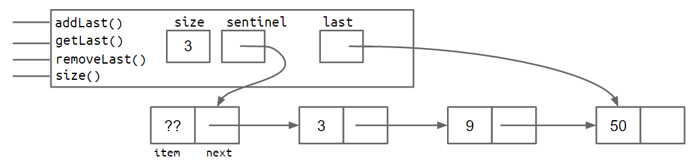

加了 `last` 后，`addLast` 和 `getLast` 都变快了，但 **`removeLast` 仍然慢**。

### 二、removeLast 的难题

要删除最后一个节点，必须先把**倒数第二个节点**的 `next` 设为 `null`，再让 `last` 指向它。问题是：**单向链表里，从 `last` 无法反向找到前驱**，只能从头再遍历一遍。

那再加一个 `secondToLast` 指针？——没用，因为删完它之后，你又需要"倒数第三"来更新它……如此无穷倒退（用归纳法一步步推就知道，靠"多缓存一个指针"这条路走不通）。

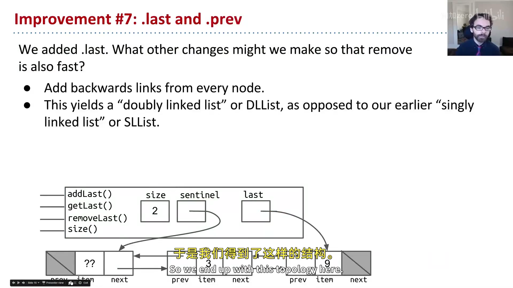

### 三、改进七：回头看（双向链表）

最自然的解法是**让每个节点多一个指向前驱的 `prev` 指针**：

```java
public class IntNode {
    public IntNode prev;
    public int item;
    public IntNode next;
}
```

每个节点有两个链接，这种结构叫**双向链表（Doubly Linked List）**，简称 `DLList`；相对的，上一讲只有 `next` 的链表叫**单向链表（Singly Linked List）**，简称 `SLList`——上一讲那个"别扭的名字 `SLList`"之谜就此揭晓：`S` = Singly。

空列表与含两项的 `DLList` 长这样：

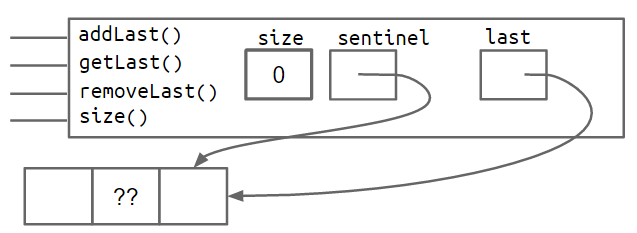

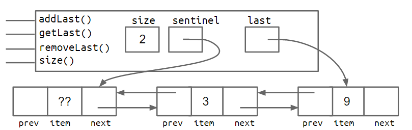

加上 `prev` 之后，在链表**两端**做添加、获取、删除都能在常数时间完成；只有"中间"操作仍需遍历。这正是现实世界链表通常采用的形态。（实现细节留到 Project 1 自己动手。）

### 四、改进八：哨兵升级（双哨兵 vs 循环哨兵）

双向链表有个隐蔽的坑：`last` 指针**有时指向哨兵节点、有时指向真实节点**——于是每个方法都要写一堆 `if` 判断特殊情况，代码又丑又容易错。

**方案 A：双哨兵**。在链表前后各放一个哨兵，元素永远插在两个哨兵之间：

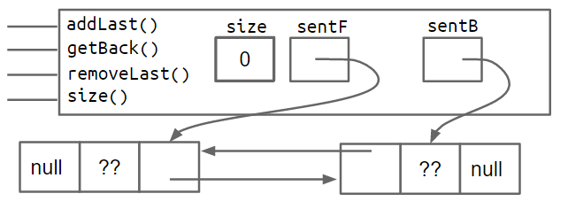

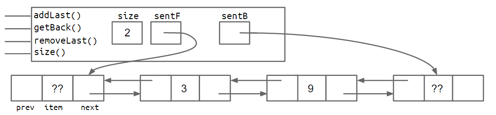

**方案 B：循环哨兵**。只用一个哨兵，让它**既当开头又当结尾**——空列表时 `sentinel.next == sentinel.prev == sentinel`；加元素后，从哨兵出发沿 `next` 一直走，最终回到哨兵自己。

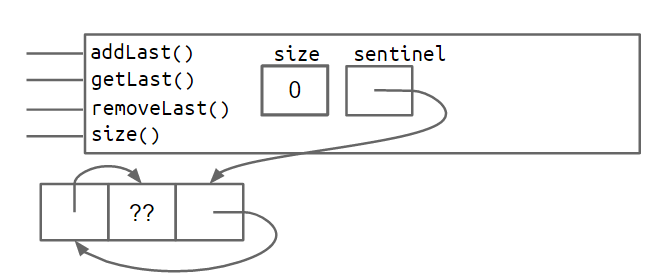

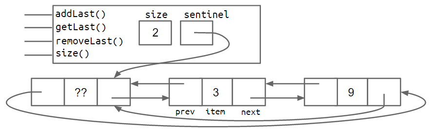

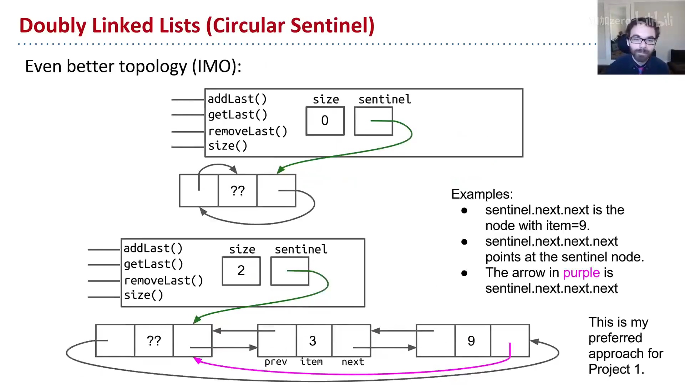

两种都能消除特殊情况。Josh 用"山顶寺庙的和尚"作比喻，推荐**循环哨兵**——它"世界是圆的，一直朝一个方向走会回到起点"，虽然初看更费解，但更纯粹、更美。做 Project 1 时他强烈建议采用。

### 五、泛型：让列表能装任意类型

`DLList` 有个致命局限：**只能存 `int`**。想存 `String` 会直接报"String 无法转换为 int"。最糟的解法是复制一个 `StringSLList` 类到处查找替换——显然不可取。

现代 Java 的正确做法是**泛型（generics，2004 年加入）**：在类名后加尖括号占位符 `<BleepBlorp>`（名字随意，`GloopGlop`、`Horse` 都行），把 `item` 的类型换成它：

```java
public class DLList<BleepBlorp> {
    public class IntNode {
        public IntNode prev;
        public BleepBlorp item;   // 占位符 = 未来才决定的类型
        public IntNode next;
        ...
    }
}
```

使用时，声明时指定具体类型，实例化时用空尖括号 `<>`（菱形运算符）：

```java
DLList<String> d2 = new DLList<>("hello");
d2.addLast("world");
```

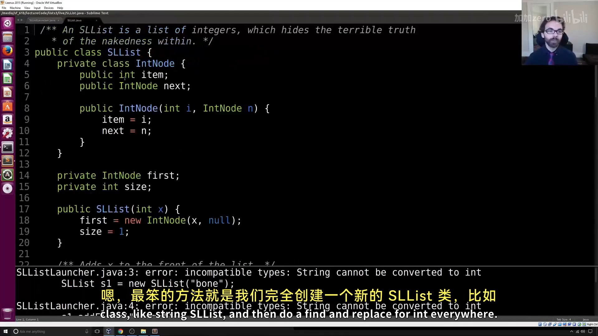

关键规则（Project 1 够用）：

- 在**实现**数据结构的 `.java` 文件里，泛型类型名只在类名后声明**一次**；
- 在**使用**数据结构的 `.java` 文件里，声明时指定具体类型，实例化时用空的 `<>`；
- 泛型只接受**引用类型**，基本类型要换成包装类：`int→Integer`、`double→Double`、`char→Character` 等（且首字母大写）。

例如：

```java
DLList<Integer> d1 = new DLList<>(5);
d1.insertFront(10);
```

到这一步，你就具备了实现 Project 1 `LinkedListDeque` 所需的全部知识。

---

## 第二部分：数组基础

### 六、数组是什么

我们已能用递归类定义构建可无限增长的列表（`IntList`、`SLList`、`DLList`）。现在换一条**正交的思路**：用数组来存储信息。

要构建列表，先要能拿到"内存盒子"。之前有两种途径：

- `int x;` → 32 位的盒子；
- `Walrus w2 = new Walrus(30, 5.6);` → 共 3 个盒子（引用 64 位 + 重量 32 位 + 獠牙 64 位）。

**数组（array）** 是第三种：一个**带编号的内存盒子序列**。类是有**名字**的盒子集合（用 `.` 访问），数组是有**编号**的盒子序列（用 `[]` 访问，如 `A[3]`）。数组的要素：

- 一个固定的长度 `N`；
- `N` 个**同类型**盒子，编号 `0` 到 `N-1`；
- 不像类，数组**没有方法**。

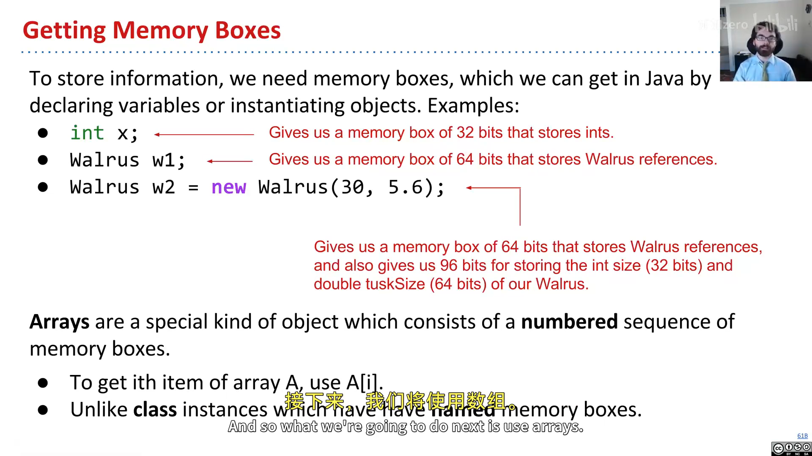

### 七、三种数组创建记法

```java
x = new int[3];                        // ① 指定长度，元素填默认值 0
y = new int[]{1, 2, 3, 4, 5};          // ② 指定值，长度自动推断
int[] z = {9, 10, 11, 12, 13};         // ③ 省略 new，只能随声明一起用
```

三种等价，无优劣之分。① 会得到长度 3、全 0 的数组；②③ 得到长度 5、含指定值的数组。创建数组时元素总会得到**默认值**（int 为 0，引用类型为 `null`）。

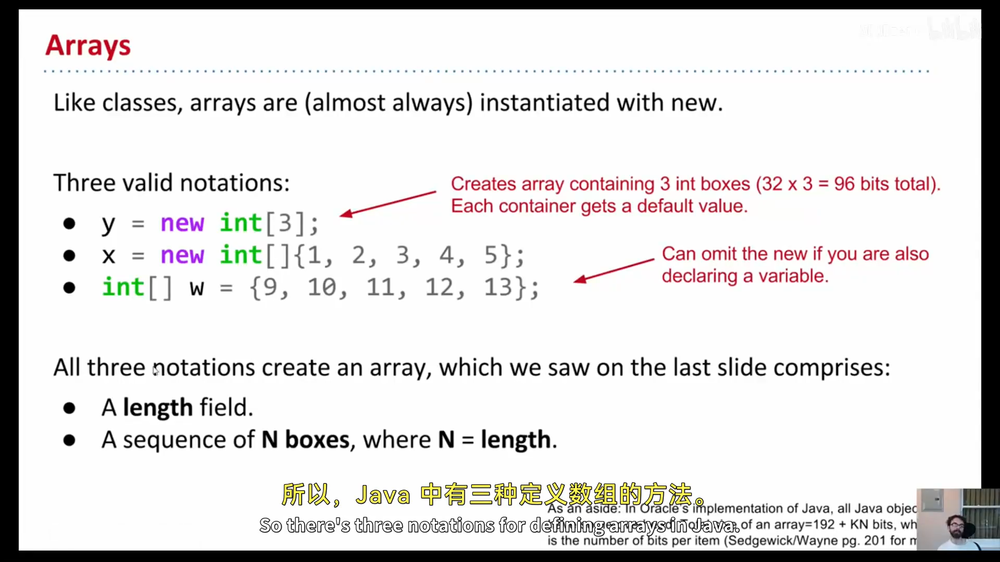

### 八、数组访问、修改与 System.arraycopy

```java
int[] z = null;
int[] x, y;
x = new int[]{1, 2, 3, 4, 5};
y = x;                          // 复制引用：x、y 指向同一数组
x = new int[]{-1, 2, 5, 4, 99}; // x 换指向，原数组只剩 y 引用
y = new int[3];                 // 新数组全 0
z = new int[0];                 // 长度 0 的数组
int xL = x.length;              // 5

String[] s = new String[6];     // 6 个 64 位盒子，默认 null
s[4] = "ketchup";
s[x[3] - x[1]] = "muffins";     // x[3]-x[1] = 4-2 = 2，即 s[2]

int[] b = {9, 10, 11};
System.arraycopy(b, 0, x, 3, 2); // 从 b[0] 起复制 2 个到 x[3] 起
```

`System.arraycopy` 的五个参数依次是：**源数组、源起始下标、目标数组、目标起始下标、复制个数**。对 Python 老手来说，`System.arraycopy(b, 0, x, 3, 2)` 等价于 `x[3:5] = b[0:2]`。

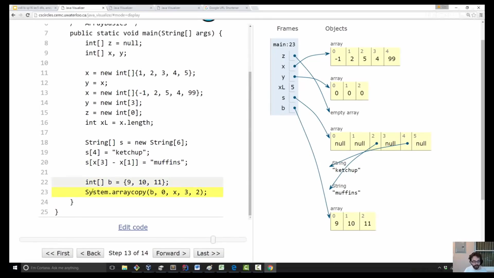

**为什么要复制数组？** 因为 `y = x` 只是复制**引用**，两个变量指向同一个数组。若要写一个"非破坏性"的函数（比如把每个元素平方、但不改原数组），就必须真正复制一份。两种复制方式：

```java
// 方式一：手写循环逐项复制
for (int i = 0; i < x.length; i++) y[i] = x[i];

// 方式二：System.arraycopy（通常更快、代码更紧凑，但参数需记忆）
System.arraycopy(x, 0, y, 0, x.length);
```

`arraycopy` 通常比循环快（Java 解释器更贴近硬件），代码也更紧凑；代价是可读性略差，取舍由你。

> **边界检查**：Java 数组只在**运行时**做边界检查——下面这段能编译通过，但运行时会崩溃（`ArrayIndexOutOfBoundsException`）：

```java
int[] x = {9, 10, 11, 12, 13};
int[] y = new int[2];
int i = 0;
while (i < x.length) { y[i] = x[i]; i += 1; }   // y[2] 越界！
```

### 九、二维数组：引用的引用

Java 里所谓的"二维数组"其实是**数组的数组**。`int[][] bamboozle = new int[4][]` 创建的是 4 个盒子，每个盒子都能指向一个 `int[]`（长度未定）。

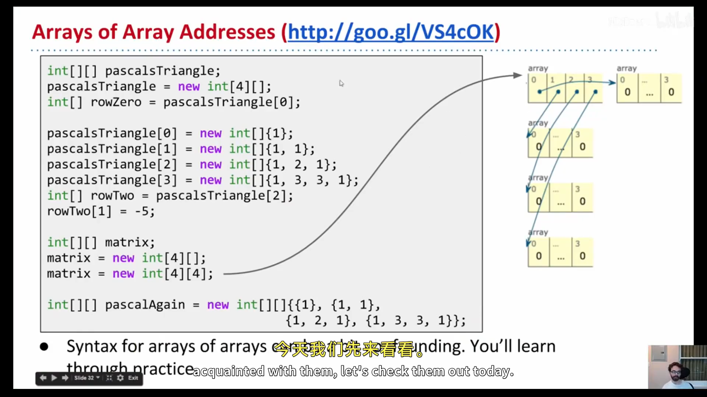

用帕斯卡三角举例：

```java
int[][] pascalsTriangle;
pascalsTriangle = new int[4][];            // 4 个引用盒子，默认 null
pascalsTriangle[0] = new int[]{1};
pascalsTriangle[1] = new int[]{1, 1};
pascalsTriangle[2] = new int[]{1, 2, 1};
pascalsTriangle[3] = new int[]{1, 3, 3, 1};

int[] rowTwo = pascalsTriangle[2];         // 复制引用，指向同一行
rowTwo[1] = -5;                            // 会影响 pascalsTriangle[2][1]！

int[][] matrix = new int[4][4];            // 第二种：直接创建 4×4 的矩形数组
int[][] pascalAgain = new int[][]{{1}, {1, 1}, {1, 2, 1}, {1, 3, 3, 1}}; // 字面量
```

关键理解：`new int[4][]` 只创建 1 个数组（引用数组）；而 `new int[4][4]` 实际创建 **5** 个数组（1 个引用数组 + 4 个 int 数组）。`rowTwo` 和 `pascalsTriangle[2]` 是同一个数组的两个引用，改一个会影响另一个。

### 十、数组 vs 类

两者都能组织一堆内存盒子，但哲学不同：

| | 类（如 Planet） | 数组 |
|---|---|---|
| 盒子命名 | 有名字（`name`、`mass`） | 编号 `0..N-1` |
| 访问方式 | 点表示法 `p.mass` | 方括号 `a[i]` |
| 盒子类型 | 可以不同 | 必须相同 |
| 数量 | 固定 | 固定（但长度是运行时值） |

最深刻的区别：**数组的索引可以在运行时计算**——用户输入几，就取 `a[几]`；而类的字段名是**编译期写死**的，你不能 `p[某个字符串]` 那样动态取字段（Java 里这会报错；想强行做只能靠"反射 API"，但那是公认的糟糕风格）。这个限制反而是 Java 的一大优点：它刻意收敛了你能做的选择，让大型程序的代码保持简单可预期。

---

## 小结

本讲完成了链表的最终进化（`SLList` → 双向 `DLList` → 泛型化），并打好数组基础。下一讲，我们将用数组构建 `AList`，并比较它与 `SLList` 的优劣。

---

## 附：官方参考与延伸阅读

- **本讲讲义一**（The DLList）：<https://joshhug.gitbooks.io/hug61b/content/chap2/chap23.html>
- **本讲讲义二**（Arrays）：<https://joshhug.gitbooks.io/hug61b/content/chap2/chap24.html>
- **Project 1（LinkedListDeque）**：<https://sp19.datastructur.es/materials/proj/proj1a/proj1a>
- **数组创建可视化**：<http://pythontutor.com/iframe-embed.html>
- **数组访问可视化**：<https://goo.gl/bertuh>
- **二维数组可视化**：<http://goo.gl/VS4cOK>
- **练习 2.4.1 可视化**：<http://goo.gl/fCZ9Dr>
- **Java 反射 API**（仅作了解，不推荐用于取字段）：Oracle 官方文档

---

> **版权与许可**：本电子书中的课堂讲解内容重构自 Josh Hug（UC Berkeley）CS61B 课程录像；课程全部材料依据 **Creative Commons 4.0 BY-NC-SA** 许可发布。请在使用时署名 Josh Hug、以相同许可共享，且不得用于商业用途。书中示意图来自官方讲义原图，演示过程截图来自原视频，相应权利归原作者与视频权利人所有。
