# CS61B 第 7 讲：AList、扩容与对比 SLList（ALists, Resizing, vs. SLists）

> **本电子书信息**
> - 来源视频：[【数据结构与算法 CS61B 2021】伯克利大学—中英字幕 p06 7_ALists, Resizing, vs. SLists](https://www.bilibili.com/video/BV1FSzNYpE7s/?p=7)
> - 课程讲义：[Hug61B · 2.5 The AList](https://joshhug.gitbooks.io/hug61b/content/chap2/chap25.html)
> - 讲义版权：本课程全部材料由 **Josh Hug**（UC Berkeley CS61B）以 **Creative Commons 4.0 BY-NC-SA** 许可发布——可自由分享、演绎，但须署名 Josh Hug、以相同许可共享，且不得商用。
> - 本书由课堂录像字幕重构而成，术语以官方讲义为准；文中示意图为官方讲义原图，演示过程图截取自视频。

上一讲我们得到了漂亮的 `DLList`——增删取都很快、没有丑陋的特殊情况。既然它这么好，为什么还要折腾数组？本讲回答这个问题：构建一个用数组存储数据的 `AList`，并在这个过程中揭示链表 `get` 的软肋、朴素扩容的性能灾难，以及"几何倍增"这一化腐朽为神奇的关键技巧。

---

## 一、链表的性能谜题：get 为什么慢

`DLList` 的 `getLast` 是常数时间，但 `get(int i)` 很慢。原因：链表只有头尾两个引用，要取第 `i` 项，必须从一端**沿链接一步步走到**目标位置。

设想一个 100 万项的列表，有人要第 500,000 项——你不得不扫过半个列表。最坏情况（取正中间项）下，`get` 耗时**与列表长度成正比**（线性时间）；而 `getLast` 无论列表多大都是常数时间。（严谨的"大 O / 大 Θ"记法本课稍后正式定义，现在先用直观理解。）

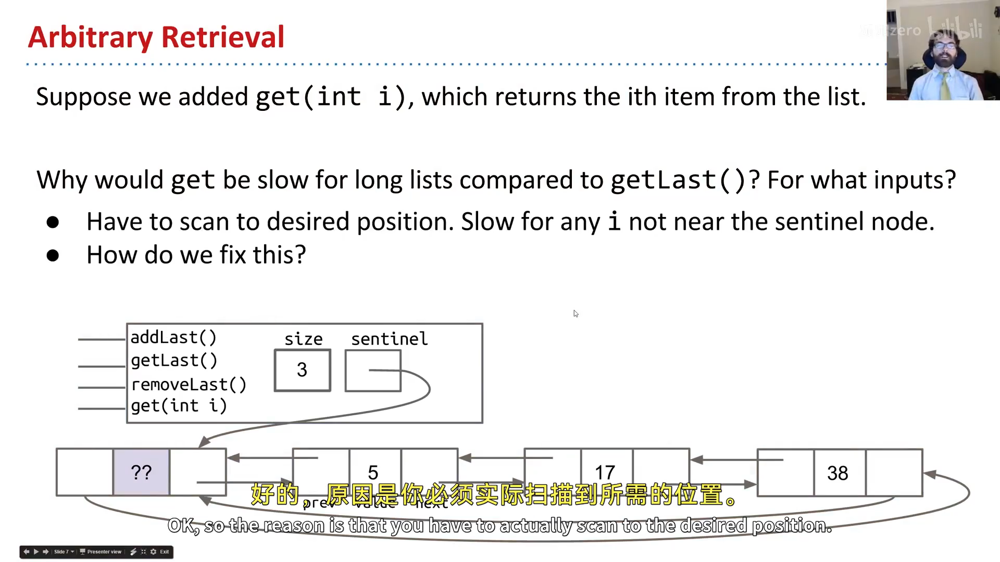

**为什么数组能更快？** 在现代计算机上，访问数组的第 `i` 项是**常数时间**——无论数组多大、要第几项，用方括号 `items[i]` 就能立即拿到（原理见讲义里的 Quora 链接，61C 会细讲）。既然没有"链接"要遍历，`get` 自然快。

于是我们换个思路，用数组实现列表——`AList`。

---

## 二、朴素数组列表：第一个 AList

我们要实现的 `AList` 支持与 `DLList` 完全相同的接口（`addLast`、`getLast`、`get`、`size`、`removeLast`），只是底层换成数组：

```java
public class AList {
    private int[] items;
    private int size;

    public AList() {
        items = new int[100];   // 先定个容量上限 100
        size = 0;
    }
}
```

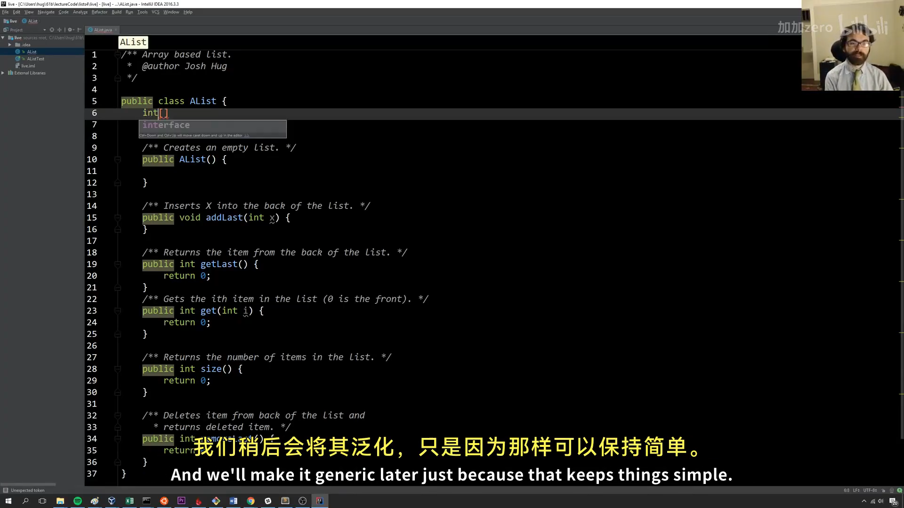

写方法前，先"手算一个小例子"抽象出**不变量**（invariants）：

1. 下一个要插入（`addLast`）的位置**总是** `size`；
2. 列表中的元素个数**总是** `size`；
3. 最后一个元素的位置**总是** `size - 1`。

有了不变量，三个方法一行到位：

```java
public void addLast(int x) { items[size] = x; size += 1; }
public int  getLast()      { return items[size - 1]; }
public int  size()         { return size; }
public int  get(int i)     { return items[i]; }
```

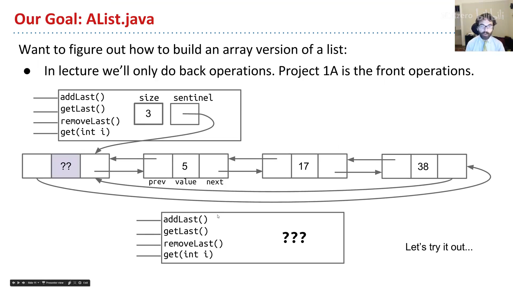

不变量就是"安全设备"：写代码时随时可查，甚至能成为数学上证明程序正确性的工具。

### removeLast 与"洞穴寓言"

实现 `removeLast` 前，Josh 讲了一个哲学类比——**柏拉图的洞穴寓言**：用户（洞穴里的人）看到的只是墙上抽象的"影子"（列表有 5、3、1、7、2、2 这些项）；我们（实现者，僧侣）在更高一层操纵**具体现实**（`size`、`items`、`items[i]` 这些内存盒子）。只要让"影子表演"符合用户预期，具体怎么改都行。

用户调用 `removeLast`，期望 -1 消失。落到具体现实上，该改哪些盒子？

- `size`：从 6 减到 5（必须——不变量要求"元素个数 == size"、"最后一项在 size-1"）；
- `items`：不必换新数组；
- `items[size]`（那个 -1）：**不必清零**——只要 `size` 减了，那个位置就被"逻辑删除"了（下次 `addLast` 会覆盖它）。

```java
public int removeLast() {
    int x = getLast();
    size -= 1;        // 只需把 size 减一，旧值留着无妨
    return x;
}
```

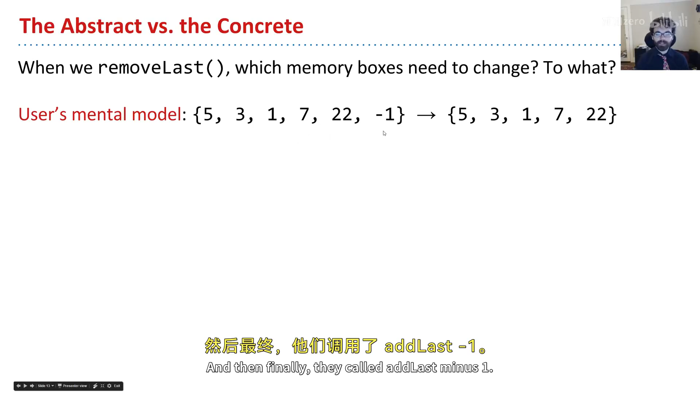

用洞穴寓言的比喻：有人用手指射中了那只鸟，我们**不必真的摧毁它**，只要把它从火光前放下（`size -= 1`）就行。

---

## 三、朴素扩容：当数组满了

`AList` 目前上限 100。当 `size == 100` 时再 `addLast`，就会抛 `ArrayIndexOutOfBoundsException`。

但 Java 数组**不能真正改变大小**。于是我们玩个小戏法：**新建一个更大的数组，把旧数据复制过去，再让 `items` 指向新数组**（旧数组由垃圾回收器销毁）：

```java
public void addLast(int x) {
    if (size == items.length) {
        int[] a = new int[size + 1];
        System.arraycopy(items, 0, a, 0, size);
        items = a;
    }
    items[size] = x;
    size += 1;
}
```

这个过程俗称"扩容（resizing）"，但严格说是个误称——数组没变，我们只是造了个**更大的新数组**。为让代码更整洁，可以抽出私有的 `resize(int capacity)` 方法，把"新建数组 + 复制 + 改指向"封装起来。

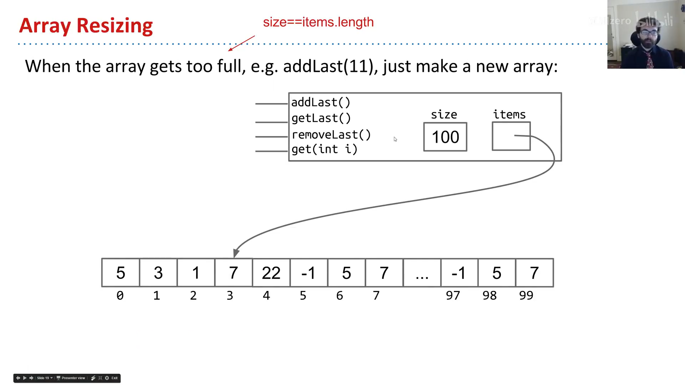

---

## 四、分析朴素扩容：一场性能灾难

跑一个实验：`SLList` 和 `AList` 各 `addLast` 100,000 次。

- `SLList`：快到几乎测不出时间；
- 朴素 `AList`：**要好几秒**。

为什么？做个小谜题：从满的 size=100 数组开始，调用 `addLast` 两次，一共要创建并填充多少个盒子？——每次扩容都要新建数组并复制全部旧数据：第一次新建 101、复制 100；第二次新建 102、复制 101；再加上插入的 1 个，合计 **203** 个盒子。

推广：从 100 一路 `addLast` 到 1000，要创建 `101 + 102 + … + 1000 ≈ 500,000` 个盒子（用 `1+2+…+n = n(n+1)/2` 估算，约 `1000²/2`）。

把"总耗时 vs 操作次数"画成图：

- `SLList` 是一条**直线**——每个 `add` 耗时恒定（常数时间；常数积分得直线）；
- 朴素 `AList` 是一条**抛物线**——每次操作耗时随规模线性增长（直线积分得抛物线）。

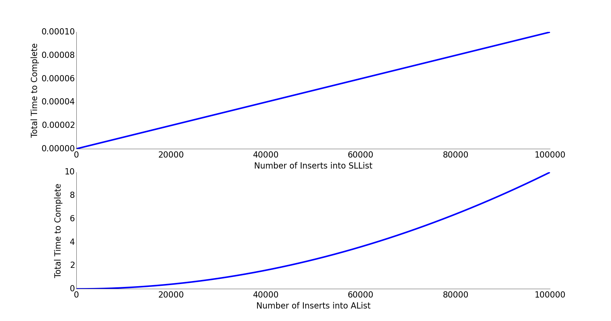

插入 10 万项，抛物线意味着约 `100000² / 100000 = 100000` 倍的差距——**绝对不能接受**。

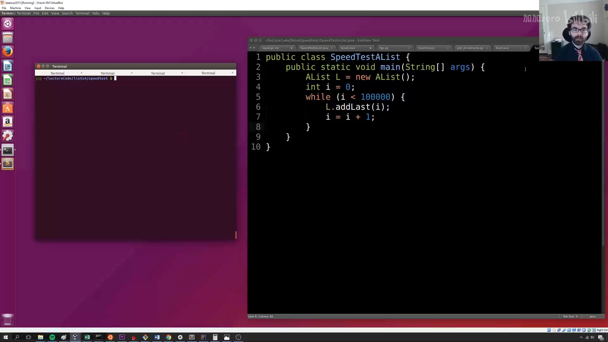

---

## 五、几何扩容：化抛物线为直线

问题出在 `resize(size + 1)`——每次只**加**一点点。解法出奇简单：**乘以一个因子**，而不是加一个常量。

```java
public void insertBack(int x) {
    if (size == items.length) {
        resize(size * RFACTOR);   // 乘法（几何）而非加法
    }
    items[size] = x;
    size += 1;
}
```

课上 Josh 现场演示了关键区别：把"每次 +10"改成"每次 ×2"后，即使把测试规模从 10 万提到 100 万、再到 1000 万，`AList` 都飞快。

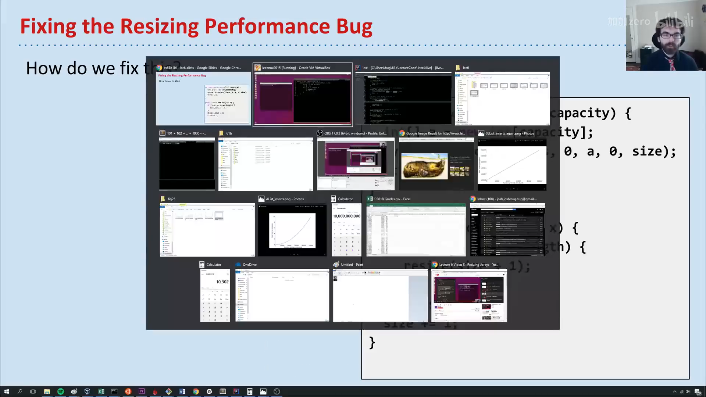

为什么"加 10"不行、非"×2"不可？加 10 只是**把问题隐藏**了——规模一大依旧原形毕露（加法本质还是线性增长）；只有乘法才能让扩容次数随规模**对数**增长，从而把摊销成本摊薄到常数级别。（完整分析留到期末章节。）

> **编者说明**：Python 内置的 `list`、Java 的 `ArrayList` 等真实实现，内部用的就是这种"几何倍增"策略。这正是本讲最核心、也最实用的一个知识点。

---

## 六、内存性能：使用率与缩容

几何扩容解决了时间，但带来空间问题：假如插入 10 亿项后删掉 9.9 亿项，我们只用了 1% 的盒子，其余 99% 全空着——纯浪费。

于是引入**使用率（usage ratio，也叫负载因子 load factor）**：

```
使用率 R = size / items.length
```

当 `R` 跌破某个阈值（典型实现取 **0.25**），就把数组**缩容**（通常减半）。下图的使用率只有 0.04，远低于 0.25，应当缩容：

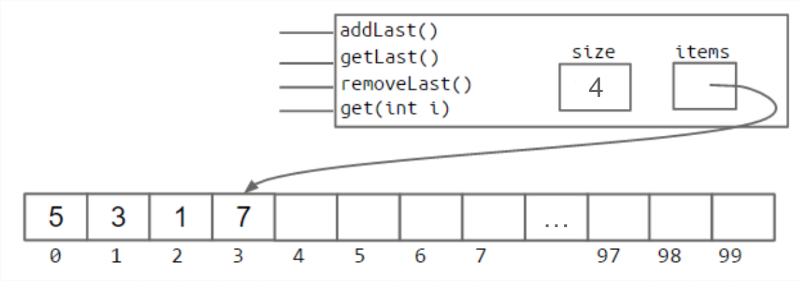

这背后是贯穿本课程的大主题：**时间与空间的权衡**——用空间换时间（缓存 size、几何扩容预留空间），或用时间换空间（缩容回收闲置盒子）。

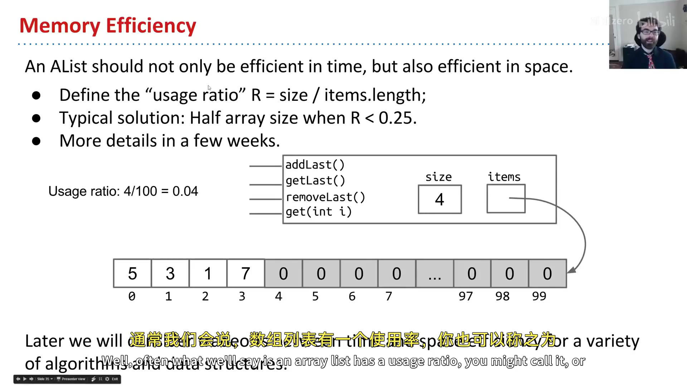

---

## 七、泛型 AList 与"滞留"陷阱

最后让 `AList` 泛型化，能装任意类型（`<Item>`）：

```java
public class AList<Item> {
    private Item[] items;
    private int size;
    ...
}
```

但这里有一个 Java 的语法坑：**不能直接 `new Item[8]`**（泛型数组不被允许）。必须用一次丑陋的强制类型转换：

```java
Item[] items = (Item[]) new Object[8];
```

这会带来一条编译警告，只能忍受——这是泛型实现方式的副作用。

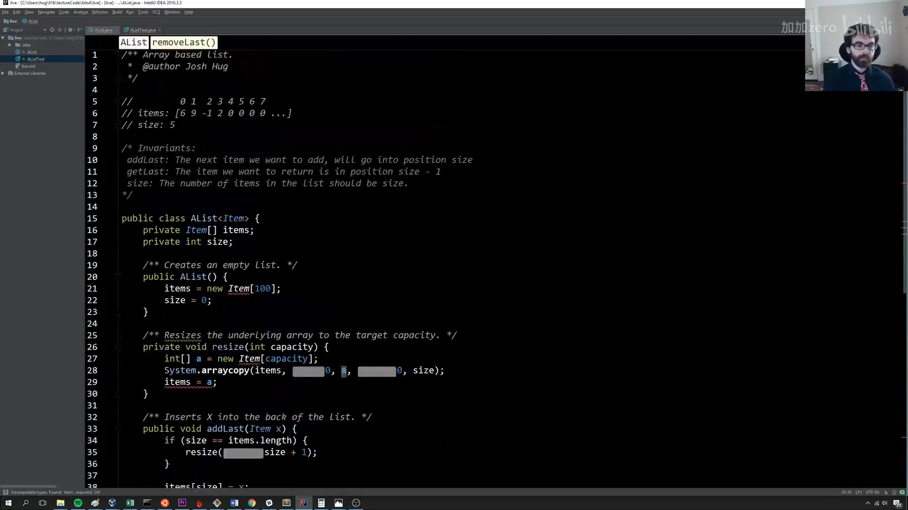

**另一个微妙改动：清除"滞留（loitering）"**。回到洞穴寓言——整数版的 `removeLast` 可以不清零旧值（反正会被覆盖）；但泛型版存的是**对象引用**，如果不把 `items[size-1]` 置为 `null`，那个对象就会一直被引用、垃圾回收器永远不会回收它。比如删掉一张 1MB 的图片后仍留着它的引用，内存就被白白占用。

```java
public Item removeLast() {
    Item x = getLast();
    items[size - 1] = null;   // 清除引用，避免 loitering
    size -= 1;
    return x;
}
```

这个 bug 很隐蔽，只在"存大量对象、又频繁删除"时才明显，但会造成严重的内存浪费。**记住：Java 只在最后一个引用丢失时才回收对象；所以，不要滞留（Don't loiter）。**

---

## 小结

`AList` 用数组换来了常数时间的 `get`，代价是 `addLast` 需要扩容。朴素扩容是性能灾难（抛物线）；换成**几何倍增**后，时间摊薄到常数级（直线），再配合使用率阈值缩容回收空间。由此也完成了链表与数组两条正交思路的对照：`SLList`/`DLList` 两端操作快、中间慢；`AList` 随机访问快、尾部插入需摊薄扩容成本。

---

## 附：官方参考与延伸阅读

- **本讲讲义**（The AList）：<https://joshhug.gitbooks.io/hug61b/content/chap2/chap25.html>
- **为什么数组访问是常数时间**（Quora）：<https://www.quora.com/Why-does-accessing-an-array-element-take-constant-time>
- **AList DIY 起始代码**：<https://github.com/Berkeley-CS61B/lectureCode/tree/master/lists4/DIY>
- **朴素实现参考**：<https://github.com/Berkeley-CS61B/lectureCode/tree/master/lists4/naive>
- **Project 1A（LinkedListDeque）**：<http://sp19.datastructur.es/materials/proj/proj1a/proj1a>
- **Discussion 3 / Lab 2**：见讲义 What's next 一节

---

> **版权与许可**：本电子书中的课堂讲解内容重构自 Josh Hug（UC Berkeley）CS61B 课程录像；课程全部材料依据 **Creative Commons 4.0 BY-NC-SA** 许可发布。请在使用时署名 Josh Hug、以相同许可共享，且不得用于商业用途。书中示意图来自官方讲义原图，演示过程截图来自原视频，相应权利归原作者与视频权利人所有。
